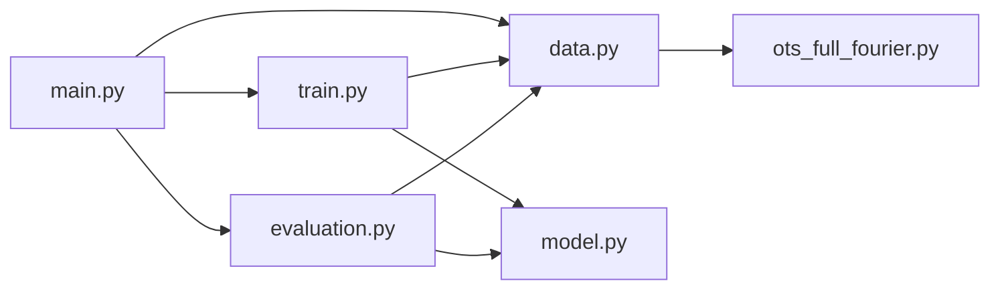
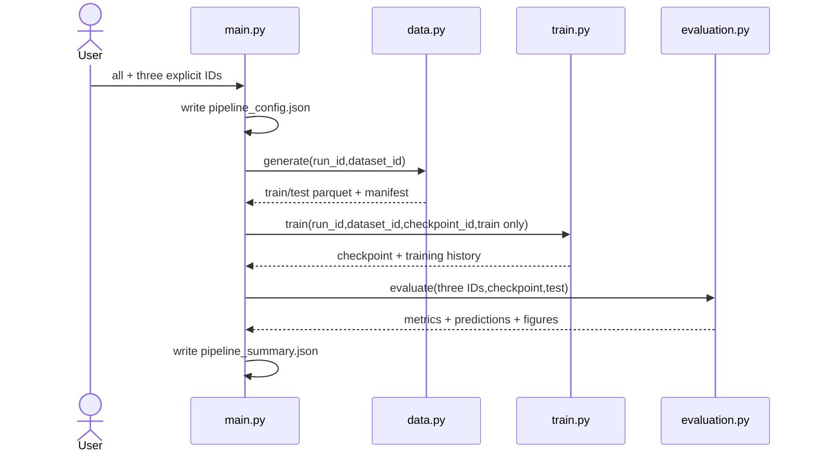

# OTS 电子 EVDF 主线重构 SPEC（待实施）

> 本文档是已讨论定稿的实施规格，不代表已授权修改源码。
>
> 范围：数据生成 → train/validation 训练 → 冻结 checkpoint 的独立 test 评估。
>
> 本轮不修改、删除、重命名或验收任何 Slurm 文件；Slurm 整理延期到服务器同步时的独立 SPEC。

## 1. Requirements（需求）

### 1.1 目标主线

```text
电子多峰 f_e(v) + 离子1/2 f_i(v)
  -> ots_full_fourier 生成三段独立归一化光谱
  -> 电子 80 个复 Fourier 系数标签
  -> train/test Parquet + dataset_manifest.json
  -> train/validation 训练并选模
  -> model.pt
  -> 独立 test 指标、预测和图
```

### 1.2 功能需求

1. `data.py` 不再调用 `phyEqns.ots_fourier` 生成光谱；主线只调用 `phyEqns.ots_full_fourier`。
2. `ft_x_n` 加入 `phyEqns/ots_full_fourier.py`，显式检查 `n>0` 且 `n<=输入速度采样点数`。
3. `OTS_spectrum_full_fourier` 直接接收电子、离子1、离子2的 `v/f`；函数内部生成三套 `K/F`，并从原始分布插值得到三种相速分布值。
4. 不引入 `target-kind`；主线仍只生成和预测当前电子多峰分布的 80 个复 Fourier 系数，Parquet 标签仍是 160 维 `[Re(F_e), Im(F_e)]`。
5. 电子有效温度用一维中心二阶矩计算。偏离配置参考温度 1370 eV 时，只记录，不自动缩放、重采样或拒绝样本。
6. 保留训练完成后的独立 test dataset、`evaluation.py`、test 指标和图。`train.py` 不接收、不读取 test。
7. 删除旧 `ModelOTS/Loss_func/pickle`、旧 `main.py`、旧 `evaluateModel.py`和单体 `train_v2.py` 的活动主线，但不删除用户数据、历史 checkpoint、远程产物或 Git 历史。
8. 不设计单元测试、characterization tests、mock 或精确到测试函数的清单。本 SPEC 只保留高层验收标准。

### 1.3 显式 ID 需求

`run_id`、`dataset_id`、`checkpoint_id` 不得硬编码、不得自动生成，也不生成 UUID；它们必须由 `main.py` CLI 显式输入：

| 子命令 | 必需 ID |
|---|---|
| `generate` | `--run-id`, `--dataset-id` |
| `train` | `--run-id`, `--dataset-id`, `--checkpoint-id` |
| `evaluate` | `--run-id`, `--dataset-id`, `--checkpoint-id` |
| `all` | `--run-id`, `--dataset-id`, `--checkpoint-id` |

缺少必需 ID 时 argparse 立即报错。下游文件中的 ID 与 CLI、manifest 或 checkpoint 不一致时立即终止。`checkpoint_id` 不进入 `dataset_manifest.json`。

### 1.4 非目标

- Slurm 脚本、提交工具、作业监控、服务器同步、哈希和模型注册。
- 离子 target、synthetic/OOD 扫描、分布式训练、checkpoint resume 或新架构模式。
- 修改 `AGENTS.md`。

## 2. Design（设计）

### 2.1 文件职责

```text
data.py        生成/读取数据，写 dataset_manifest.json
model.py       网络、Hermitian 投影、checkpoint 加载
train.py       仅 train/validation 训练与选模
evaluation.py  仅冻结 checkpoint 的独立 test 推理、指标和图
main.py        唯一 CLI，透明串联 generate/train/evaluate/all
phyEqns/ots_full_fourier.py  三物种 v/f 正向物理
```



`train.py` 禁止导入 `evaluation.py`；`data.py` 禁止调用 `ots_fourier` 正向函数。

#### Legacy 清理边界

- 原位重写根目录 `model.py`、`train.py`、`main.py`，新增 `data.py`、`evaluation.py`。
- 新主线验收后，删除已被替代且不再有保留调用者的根目录 `train_v2.py`、`evaluateModel.py`、`quick_test.py`、`genDataSet.py`、`genDataSet_full_fourier.py`、`readData.py`。
- 保留 `phyEqns/ots_fourier.py`，因为论文复现等非本主线代码仍可能使用它；但新 `data.py` 不得导入或调用它。
- 保留 `paper_reproduction/`、报告、已有数据、checkpoint、远程产物和 Git 历史。
- 本轮 Slurm 文件保持字节不变。它们若仍引用上述旧文件，属于已知的暂时失配，留到服务器同步的独立 SPEC 处理；本轮不以 Slurm 可运行为验收条件。

### 2.2 主流程



数据角色严格区分：

- `train`：`dataset_train.parquet` 固定划分后的训练子集，用于梯度更新和训练统计量。
- `validation`：同一 train Parquet 中由 seed 固定留出的不相交子集，只用于逐 epoch 观察、early stopping 和候选模型选择。它衡量同生成分布的留出泛化，不宣称是额外的 OOD 外推实验。
- `test`：由独立 seed 生成的 `dataset_test.parquet`，训练、标准化、early stopping 和选模均不得读取；只在冻结 checkpoint 后由 `evaluation.py` 使用一次。

### 2.3 输出目录

```text
RUN_DIR/
├── pipeline_config.json
├── pipeline_summary.json
├── data/
│   ├── dataset_train.parquet
│   ├── dataset_test.parquet
│   └── dataset_manifest.json
├── training/
│   ├── model.pt
│   ├── training_history.json
│   └── learning_curves.png
└── evaluation/
    ├── metrics.json
    ├── predictions.npz
    ├── comparison.png
    └── sample_detail.png
```

### 2.4 四个 JSON 合同

JSON 中的所有相对路径都以“该 JSON 文件所在目录”为基准，不依赖当前工作目录：manifest 中的 Parquet 通常是同目录文件名，history/metrics 用相对路径指向输入和同目录产物，summary/config 则从 run 根目录引用全流程产物。路径来自实际 `Path` 计算，不手抄固定字符串。

#### `pipeline_config.json`

在 `all` 计算开始前写入，记录用户显式输入的 `run_id/dataset_id/checkpoint_id`、目录、样本数、seed、训练超参和评估参数。它不记录逐样本温度、epoch 历史或 test 结果。

#### `dataset_manifest.json`

顶层严格只有四个键：

```text
run_id
dataset_id
physical_configuration
splits
```

不得增加 `format_version`、`checkpoint_id`、`family`、温度定义、源码路径字符串、空 ion 对象或只能手抄源码常量才能填写的字段。

构造合同（右侧为唯一数据来源）：

```text
run_id                         <- CLI args.run_id
dataset_id                     <- CLI args.dataset_id
physical_configuration:
  fourier_modes                <- 实际传给 ft_x_n 的运行变量
  probe_wavelength_nm          <- 实际 lm_0 / 1e-9
  scattering_angle_deg         <- 从实际 k_sh/ss 向量计算
  electron_density_m3          <- 实际传给正向函数的 n_e
  electron_dis:
    configured_reference_temperature_ev <- 实际用于计算 ratio 的变量
    velocity_points            <- len(v_e)
    velocity_range_c           <- [min(v_e)/c,max(v_e)/c]
  wavelength_bands_nm          <- 从实际三个 wavelength tensor 计算 start/stop/points
splits:
  train/test:
    file                       <- 实际写入文件的相对路径
    seed                       <- CLI seed / CLI seed+1
    physical_samples           <- 实际生成记录数
    samples[]:
      row                      <- 实际 Parquet 物理行号
      mean_velocity_m_s        <- 从当前 v_e/f_e 计算
      effective_temperature_ev <- 从当前 v_e/f_e 中心二阶矩计算
      ratio_to_configured      <- effective/configured
    statistics                <- 分别对上述三个派生值计算 min/max/mean/median/std
```

`statistics` 的结构固定为：

```text
statistics:
  mean_velocity_m_s:
    min/max/mean/median/std
  effective_temperature_ev:
    min/max/mean/median/std
  ratio_to_configured:
    min/max/mean/median/std
```

`electron_dis` 没有 `family` 和温度定义字段。配置参考温度只在 `electron_dis` 中记录一次；逐样本温度只在 `splits.train/test.samples` 中记录，不重复到顶层。

#### `training_history.json`

记录 `run_id/dataset_id/checkpoint_id`、train data/manifest/checkpoint 的实际相对路径、实际训练超参、train/validation 样本数、每个候选的逐 epoch `train_loss/validation_loss/learning_rate`、早停原因、best epoch/loss 和最终候选。不包含 test 指标、test 预测或模型权重。

#### `pipeline_summary.json`

在全流程成功后写入，记录三个 ID，以及 config、manifest、train/test Parquet、history、checkpoint、metrics、predictions 和图的实际相对路径。可保存 selected candidate 和 best validation loss 的摘要，但不复制完整 epoch 历史、逐样本温度或整套 test 指标。

### 2.5 checkpoint 和 evaluation metrics

`model.pt` 必须保存：三个 ID、模型 state、hidden sizes/dropout、LayerNorm、LeakyReLU slope、输入/输出维度、固定 80 modes、`x/y mean/scale`、K/波长网格、selected candidate、best epoch/loss、device 和 dtype。其 `training_config` 保存训练时实际解析后的完整值：seed、validation fraction、候选 hidden sizes/dropout、batch size、max epochs、patience、learning rate、weight decay、raw-loss weight、gradient-clip norm，以及优化器和 scheduler 的名称与全部参数。checkpoint 不包含 test 指标或 test 预测。

`evaluation/metrics.json` 必须保存三个 ID、实际 checkpoint/test data 相对路径和全部 test 指标；不回写 checkpoint 或 training history。

## 3. 逐函数设计（接口与伪代码）

### 3.1 `phyEqns/ots_full_fourier.py`

#### `ft_x_n(v: Tensor, f: Tensor, n: int) -> tuple[Tensor, Tensor]`

- `v:[N]`，m/s，float32/64；`f:[N]`，s/m，实数。
- 要求 `v/f` 一维、等长且 `N>=3`，值 finite，`v` 严格递增且近似均匀。
- 要求整数 `n>0` 且 `n<=N`；失败消息显示 n 和 N。
- 返回 `K:[n]`（s/m）与 `F:[n]`（复数、无量纲）。

```text
validate v/f shapes, values and uniform increasing grid
validate integer n and 0<n<=len(v)
dx=v[2]-v[1]; L=len(v)*dx; dk=2*pi/L
K=linspace(-1,1,n)*dk*n/2
for each K_j: F_j=trapz(f*exp(-i*K_j*v),v)
return K,F
```

#### `_validate_distribution(v: Tensor, f: Tensor, name: str) -> tuple[Tensor, Tensor]`

```text
require one-dimensional equal-length arrays with at least three points
require finite strictly increasing approximately uniform velocity grid
require real finite non-negative f
integral=trapz(f,v)
require integral approximately one (rtol 1e-5, atol 1e-8)
return validated tensors without renormalizing
```

#### `interpolate_distribution(v: Tensor, f: Tensor, query_velocity: Tensor) -> Tensor`

```text
locate adjacent grid points using searchsorted
return exact endpoint values at v[0]/v[-1]
linearly interpolate strictly inside the grid
return zero below v[0] or above v[-1]
preserve query shape; never extrapolate or wrap periodically
```

#### `OTS_spectrum_full_fourier(...) -> Tensor`

```python
def OTS_spectrum_full_fourier(
    lms, ss, k_sh, E_i0, lm_0, n_e,
    Z_i1, N_i1, m_i1, Z_i2, N_i2, m_i2, V,
    *,
    v_e, f_e, v_i1, f_i1, v_i2, f_i2,
    u_e, u_i1, u_i2,
    fourier_modes=80,
):
    ...
```

- `lms:[M]`、`lm_0`：m，均为正；`ss:[3]`、`k_sh:[3]`：finite、非零的无量纲方向向量，内部归一化。
- `E_i0:[3]`：finite 的无量纲入射偏振方向；保留接口但分段归一化输出不使用绝对功率因子。`V`：m³，同样只保留接口。
- `n_e`：m⁻³且为正；`Z_i1/Z_i2`：无量纲电荷态；`N_i1/N_i2`：无量纲非负数密度比例，且电荷加权和为正；`m_i1/m_i2`：kg且为正。
- `u_e/u_i1/u_i2:[3]`：m/s；`v_*:[N_s]`：m/s；`f_*:[N_s]`：s/m，实数非负且各自速度积分为 1。
- 三套 `v/f` 的点数可以不同，但每套必须等长、至少 3 点、finite，速度严格递增且近似均匀。
- 三物种共用一个正整数 `fourier_modes`，且它不超过任一物种的速度点数；主线固定为 80。
- 输入转换到 `lms` 所在 device，并沿用其 float32/float64 实数精度；返回同 device 的实数 `[M]` 当前波段归一化强度。三波段分别调用，保持分段归一化。

```text
validate geometry/scalars and the three normalized distributions
require 0<fourier_modes<=min(len(v_e),len(v_i1),len(v_i2))
K_e,F_e=ft_x_n(v_e,f_e,fourier_modes)
K_i1,F_i1=ft_x_n(v_i1,f_i1,fourier_modes)
K_i2,F_i2=ft_x_n(v_i2,f_i2,fourier_modes)
compute scattering vector, frequency shift and three phase velocities
f_e_phase=interpolate_distribution(v_e,f_e,v_phase_e)
f_i1_phase=interpolate_distribution(v_i1,f_i1,v_phase_i1)
f_i2_phase=interpolate_distribution(v_i2,f_i2,v_phase_i2)
compute three Fourier Landau responses, susceptibilities and dielectric
assemble structure factor from interpolated f values and screening factors
apply frequency correction; normalize by finite positive max(abs(power))
return intensity
```

新 `v/f` 参数位于 `*` 之后，防止旧位置 `K/F` 调用被静默误解。仓库没有需要维持的外部 API，因此不设计自动猜测兼容层；移除本模块语义含混的 `OTS_spectrum_fft` 别名，保留唯一公共名 `OTS_spectrum_full_fourier`。实施时迁移保留的 Python 调用者，待删除的 legacy 调用者直接按清理边界删除，但不改 Slurm。

### 3.2 `data.py`

#### `OTSDataset`

```python
@dataclass(frozen=True)
class OTSDataset:
    spectra: torch.Tensor          # [N,1224]
    coefficients: torch.Tensor     # [N,160]
    wavelengths_nm: torch.Tensor   # [1224]
    k_grid: torch.Tensor           # [80]
```

#### `normalize_distribution(v: Tensor, f: Tensor, name: str) -> Tensor`

```text
validate equal one-dimensional finite arrays
require real non-negative f
integral=trapz(f,v); require finite positive integral
return f/integral
```

#### `sample_electron_evdf(num_points: int, rng) -> tuple[Tensor, Tensor]`

```text
build velocity grid [-0.8c,0.8c]
sample current three background plus one weak-hot Gaussian components
sum and normalize the distribution
return v_e,f_e
```

#### `build_fixed_ion_distributions(reference_temperature_ev: float=171.3) -> dict`

```text
for H and C masses compute v_th=sqrt(T_ev*e/mass)
build 1000-point grids [-12*v_th,12*v_th]
build and normalize Maxwellian f_i1/f_i2
return the actual v_i1/f_i1/v_i2/f_i2 runtime tensors
```

#### `electron_moments(v_e: Tensor, f_e: Tensor, configured_ev: float) -> dict`

```text
norm=trapz(f_e,v_e)
require configured_ev>0 and finite
mean=trapz(v_e*f_e,v_e)/norm
variance=trapz((v_e-mean)^2*f_e,v_e)/norm
effective_ev=m_e*variance/e
ratio=effective_ev/configured_ev
require finite results; do not alter or reject the sample because of ratio
return mean_velocity_m_s,effective_temperature_ev,ratio_to_configured
```

#### `build_wavelength_bands(dtype: torch.dtype) -> tuple[Tensor, Tensor, Tensor]`

```text
construct the actual 579/304/341 wavelength tensors in metres
return ion,red,blue bands used by the forward calls
```

#### `generate_sample(rng: numpy.random.Generator, physical_config: dict, ion_distributions: dict) -> dict`

```text
sample v_e/f_e and compute electron_moments
K_e,F_e=ots_full_fourier.ft_x_n(v_e,f_e,80)
for each actual wavelength band call OTS_spectrum_full_fourier with three v/f pairs
concatenate the three spectra and concatenate real(F_e),imag(F_e)
validate [1224]/[160]/[80] finite outputs
return spectrum,label,K_e,moment_record
```

#### `temperature_statistics(records: list[dict]) -> dict`

```text
for mean_velocity_m_s,effective_temperature_ev,ratio_to_configured
compute min,max,mean,median,population-std(ddof=0) from actual records
return statistics; reject empty/non-finite inputs
```

#### `generate_dataset_pair(run_id: str, dataset_id: str, output_dir: Path, train_samples: int, test_samples: int, seed: int, overwrite: bool=False) -> dict`

```text
validate non-empty run_id/dataset_id and preflight three output files
build shared runtime physical variables, wavelength bands and ion distributions
generate train with seed and test with seed+1
write metadata-first Parquet files using actual paths
construct manifest with exactly four top-level keys and only audited runtime-derived fields
write manifest without checkpoint_id
return actual paths, counts and summaries
```

#### `load_dataset(path: Path) -> OTSDataset`

```text
read first 1384 columns
separate row zero metadata from every remaining physical row
construct CPU float32 tensors without dropping the last row
call validate_dataset and return the dataset
```

#### `validate_dataset(dataset: OTSDataset) -> None`

```text
require spectra [N,1224], coefficients [N,160], wavelengths [1224], K [80]
require equal positive sample counts and finite values
require increasing approximately uniform K and 579/304/341 wavelength layout
```

### 3.3 `model.py`

#### `OTSRegressor.__init__(hidden_sizes: tuple[int,int], dropout: float) -> None`

```text
validate two positive hidden sizes and 0<=dropout<1
build 1224 -> Linear/LayerNorm/LeakyReLU/Dropout -> Linear/LayerNorm/LeakyReLU/Dropout -> 160
call reset_parameters
```

#### `OTSRegressor.reset_parameters() -> None`

```text
Kaiming-normal initialize each Linear weight with a=0.05
zero each Linear bias; leave LayerNorm defaults
```

#### `OTSRegressor.forward(spectra: Tensor) -> Tensor`

```text
return the sequential network output; do not normalize or project inside forward
```

#### `hermitian_project(coefficients: Tensor) -> Tensor`

```text
require final dimension 160
project real half to 0.5*(real+reverse(real))
project imaginary half to 0.5*(imag-reverse(imag))
return concatenated result
```

#### `validate_checkpoint(payload: dict) -> None`

```text
require all three IDs, architecture/state, normalization tensors, grids and complete training config
require electron target dimensions 1224/160/80
reject legacy pet1/pickle payloads and any missing/mismatched field
```

#### `load_model_checkpoint(path: Path, device: torch.device, run_id: str, dataset_id: str, checkpoint_id: str) -> tuple[OTSRegressor,dict]`

```text
load trusted checkpoint with map_location
validate schema and require all three stored IDs equal CLI IDs
rebuild architecture, strictly load state, set eval
return model,payload
```

### 3.4 `train.py`

#### `set_determinism(seed: int) -> None`

```text
seed Python,NumPy,Torch and CUDA; disable cudnn benchmark and enable deterministic mode
```

#### `choose_device(requested: str) -> torch.device`

```text
accept cpu/cuda/auto; reject unavailable explicitly requested CUDA; otherwise return resolved device
```

#### `split_train_validation(dataset: OTSDataset, fraction: float, seed: int) -> tuple[Tensor,Tensor,Tensor,Tensor]`

```text
validate fraction and sample count
make seeded local permutation of train dataset only
return disjoint x_train,y_train,x_validation,y_validation
```

#### `normalization_statistics(x_train: Tensor, y_train: Tensor) -> tuple[Tensor,Tensor,Tensor,Tensor]`

```text
compute means and population standard deviations from training subset only
floor x_scale at 1e-4 and y_scale at 1e-8
return x_mean,x_scale,y_mean,y_scale
```

#### `coefficient_loss(predicted_normalized: Tensor, target_raw: Tensor, y_mean: Tensor, y_scale: Tensor, raw_loss_weight: float) -> Tensor`

```text
inverse-standardize prediction and Hermitian-project it
compute standardized MSE and raw MSE normalized by mean(y_scale^2)
return (1-w)*standardized_mse+w*normalized_raw_mse
```

#### `run_epoch(model: OTSRegressor, loader: DataLoader, optimizer, device: torch.device, statistics: dict, config: dict, training: bool) -> float`

```text
set model mode
for each batch run forward and coefficient_loss
if training: zero grad, backward, gradient clip and optimizer step
accumulate sample-weighted finite loss and return its mean
```

#### `train_candidate(hidden_sizes: tuple[int,int], train_loader: DataLoader, validation_loader: DataLoader, device: torch.device, statistics: dict, config: dict) -> dict`

```text
build a fresh candidate and AdamW/ReduceLROnPlateau
run train and validation epochs; record loss/lr each epoch
clone the best validation state; early-stop after configured patience
return architecture,history,best epoch/loss,state,elapsed and stop reason
```

#### `train_model(run_id: str, dataset_id: str, checkpoint_id: str, train_data_path: Path, manifest_path: Path, output_dir: Path, config: dict, overwrite: bool=False) -> dict`

```text
validate non-empty IDs and manifest run_id/dataset_id match CLI
resolve train_data_path and require it matches manifest splits.train.file
load train dataset only; split train/validation and compute training-only normalization
train each configured candidate and select minimum validation loss only
save model.pt containing IDs,state,normalization,grids and complete config
write training_history.json with IDs and no test data/results
write learning curves and return actual artifact paths/validation summary
```

### 3.5 `evaluation.py`

#### `reconstruct_real_evdf(coefficients: Tensor, k_grid: Tensor) -> tuple[Tensor,Tensor]`

```text
validate [N,160] and [80]
perform explicit trapezoidal inverse integral Re(F)cos(Kv)-Im(F)sin(Kv)
return velocity grid and real EVDF without implicit complex-to-real cast
```

#### `predict_coefficients(model: OTSRegressor, spectra: Tensor, checkpoint: dict, batch_size: int, device: torch.device) -> Tensor`

```text
set eval/no_grad; batch spectra
normalize with checkpoint x statistics; run model
inverse-normalize with y statistics and Hermitian-project
return concatenated CPU predictions
```

#### `prediction_metrics(target: Tensor, predicted: Tensor, k_grid: Tensor) -> dict`

```text
compute coefficient MAE/RMSE/R2 and Hermitian error
reconstruct true/predicted EVDF
compute EVDF MAE/RMSE/R2, relative-L2 mean/median and negative-mass fraction
use explicit denominator floors and reject non-finite results
```

#### `evaluate_checkpoint(run_id: str, dataset_id: str, checkpoint_id: str, checkpoint_path: Path, test_data_path: Path, manifest_path: Path, output_dir: Path, config: dict, overwrite: bool=False) -> dict`

```text
validate non-empty IDs; require manifest run/dataset IDs and checkpoint three IDs match CLI
resolve test_data_path and require it matches manifest splits.test.file
load frozen checkpoint and independent test dataset; validate grids/dimensions
predict without gradients; compute metrics
write metrics.json with IDs and actual relative input paths
write predictions.npz, comparison.png and sample_detail.png
do not modify checkpoint/history; return metrics and artifact paths
```

### 3.6 `main.py`

#### `build_parser() -> argparse.ArgumentParser`

```text
create generate/train/evaluate/all subcommands
require run+dataset IDs for generate
require all three IDs for train/evaluate/all
add explicit data,training,evaluation paths and existing v2 hyperparameters
show defaults; expose no target-kind or Slurm behavior
```

#### `write_json(path: Path, payload: dict, overwrite: bool=False) -> None`

```text
refuse implicit overwrite; create parent; write sorted indented UTF-8 JSON to the exact path
```

#### `run_generate(args: argparse.Namespace) -> dict`

```text
print IDs/config/paths; call generate_dataset_pair with run+dataset IDs; print and return artifacts
```

#### `run_train(args: argparse.Namespace) -> dict`

```text
print all three IDs and resolved hyperparameters
call train_model with train path and manifest only; print and return validation/artifacts
```

#### `run_evaluate(args: argparse.Namespace) -> dict`

```text
print all three IDs and frozen checkpoint/test inputs
call evaluate_checkpoint; print and return test metrics/artifacts
```

#### `run_all(args: argparse.Namespace) -> dict`

```text
preflight all outputs and write pipeline_config.json containing explicit inputs
call generate with run+dataset IDs
call train with all three IDs and train data only
call evaluate with all three IDs,checkpoint,test and manifest
write pipeline_summary.json containing IDs and actual relative artifact paths
return summary
```

#### `main() -> None`

```text
parse CLI and dispatch exactly one subcommand
do not hide operational exceptions; print one completion line only on success
```

## 4. Tasks（任务拆解）

1. **T1 — full-Fourier API**：实现新 `ft_x_n`、分布验证、线性插值和三 `v/f` 公共接口；迁移 Python 调用者，不改 Slurm。
2. **T2 — data.py**：迁移电子多峰数据，构造两种离子实际分布，生成温度派生值和最小 manifest。
3. **T3 — model.py/train.py**：迁移 v2 模型与 train/validation，加入显式 ID 与完整 checkpoint/history。
4. **T4 — evaluation.py**：迁移独立 test 推理、指标、预测和图，不迁移 legacy/synthetic 分支。
5. **T5 — main.py**：实现四子命令、显式 ID 传递和四 JSON 合同。
6. **T6 — legacy 清理**：新主线验收后，按 2.1 的明确清单删除/替换根目录 legacy Python 文件并检查没有保留调用者；不动 Slurm、论文复现路径、数据、远程产物或 `AGENTS.md`。
7. **T7 — 人工验收**：用正常小数据 CLI 生成全部产物，展示每阶段 diff/产物，用户确认后才进入下一阶段。

实施必须在 T1、T2、T3、T4、T5/T6 后分别暂停并向用户展示，不得在一轮中自动全部完成。

## 5. Acceptance Criteria / Tests（高层验收标准）

1. 主线数据生成只使用 `ots_full_fourier`；新 `ft_x_n` 正确拒绝 `n<=0` 和 `n>速度点数`。
2. 正向函数只接收三物种归一化 `v/f`，内部生成三套 Fourier 表示，相速分布值来自原始网格线性插值，越界为 0。
3. Parquet 仍满足 1224 输入、160 电子标签和 metadata-first 合同；不出现 target-kind。
4. `dataset_manifest.json` 顶层恰好是 `run_id/dataset_id/physical_configuration/splits`，不包含 checkpoint ID、family、温度定义、空占位或无运行来源字段。
5. manifest 的 mean velocity、effective temperature、ratio 和统计均来自实际样本；不因偏离 1370 eV 改动样本。
6. 四个 CLI 按规定要求显式 ID；不硬编码、不自动生成；下游 ID 不匹配会失败。
7. `train.py` 不打开 test，标准化和选模仅使用 train/validation；checkpoint/history 不含 test 结果。
8. `evaluation.py` 只使用冻结 checkpoint 和独立 test，产生 finite Fourier/EVDF 指标、predictions 和两张图，不修改 checkpoint/history。
9. `pipeline_config`、`training_history`、`pipeline_summary`、checkpoint 和 metrics 的 ID/路径引用一致；完整训练超参存在 JSON history 和 checkpoint。
10. legacy Python 训练入口不再活动，且本轮没有修改 Slurm、`AGENTS.md`、用户数据或远程产物。

## 6. 预期 CLI（尚未实现）

```bash
python main.py generate --run-id RUN --dataset-id DATASET --output-dir runs/demo/data --train-samples 5000 --test-samples 100 --seed 20260710

python main.py train --run-id RUN --dataset-id DATASET --checkpoint-id CHECKPOINT --train-data runs/demo/data/dataset_train.parquet --dataset-manifest runs/demo/data/dataset_manifest.json --output-dir runs/demo/training

python main.py evaluate --run-id RUN --dataset-id DATASET --checkpoint-id CHECKPOINT --checkpoint runs/demo/training/model.pt --test-data runs/demo/data/dataset_test.parquet --dataset-manifest runs/demo/data/dataset_manifest.json --output-dir runs/demo/evaluation

python main.py all --run-id RUN --dataset-id DATASET --checkpoint-id CHECKPOINT --run-dir runs/demo --train-samples 5000 --test-samples 100 --seed 20260710
```
