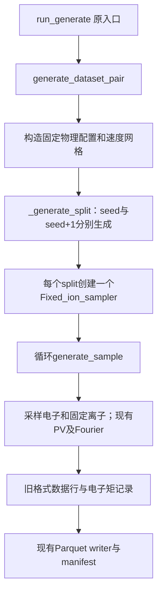

# SPEC：修复 sampler 重构后的 fixed_ion 兼容性

日期：2026-10-19。状态：独立子agent已实施，主agent已完成fixed_ion核心独立验收；CLI注册相关4项测试受本机符号链接权限限制。下文设计保留，实测结果见第6节。

## 1. Requirements（需求）

保留用户新增的 `DistributionSampler` / `Fixed_ion_sampler` 结构，修复当前 `data.py`，使原有 `run_generate -> generate_dataset_pair -> _generate_split -> generate_sample` 调用链能够生成 fixed_ion 数据，且数值与数据使用行为保持原样。

作为已有数据生成、训练和评估流程的使用者，我希望继续使用原命令及模型：相同 seed 得到相同物理采样，输出仍能被现有 loader、训练和评估读取。

### 1.1 对照版本与边界

- 修复起点：当前工作树，HEAD 为 `8113141`，叠加用户尚未提交的漂移字段、`dataset="fixed_ion"` 和样本数修改。
- 行为基准：重构前的 `fac9f98:data.py`。该版本已经调用 `OTS_spectrum_PV`；不是旧的 full-Fourier 正向路径。当前物理模块与该提交无差异。
- 保留 sampler 类名及三个采样方法。只修复必要的数据衔接，不回退成两套独立生成模块，不新增工厂、注册表或新文件格式。
- 本阶段固定输入1224、电子输出160、Fourier模式80。H/C参与正向计算，但不增加网络目标。用户已经计算的离子 Fourier 返回项可以保留，不写入旧 Parquet。
- `Fig1_Fig11_sampler` 保持未实现且不被选中；不读取论文锚点、不增加分布族、不改网络、不加卷积或观测扰动，不进行正式训练。
- 本 SPEC 是当前 fixed_ion 修复依据；此前三VDF SPEC中的新数据模块、NPZ及扩展流程不在本阶段实施。

“行为一致”指相同随机序列、物理参数、数值结果、Parquet布局和原 manifest 字段含义一致；不要求重构后内部函数签名与旧版本一致，也不要求 Parquet 文件二进制哈希相同。保留用户新增的物种说明与数据集类型字段。

### 1.2 当前代码审查结论

| 位置 | 当前问题 | 本阶段处理 |
|---|---|---|
| `_physical_config` | 三个 `*_velocity_grid` 存的是整数1000；采样及manifest把它们当数组 | 初始化实际速度网格 |
| `Fixed_ion_sampler.sample_electron_vdf` | NumPy数组与Torch网格混算，且对Tensor调用 `torch.from_numpy` | 明确类型边界；返回已有的速度网格 |
| `generate_dataset_pair` 返回值 | `len(train_rows)` / `len(test_rows)` 包含metadata行，多计1 | 返回物理行数 |
| manifest `splits` | 缺少 `physical_samples`；现有 `evaluation.py` 会拒绝 | 恢复每个split的物理样本数 |
| 样本及manifest | 原电子矩、逐行记录、统计和参考温度被删除 | 复用现有矩/统计函数，恢复原字段 |
| 现有数据测试 | 仍调用已删除的两个函数，且真实样本测试监听full-Fourier而非PV | 调整调用到sampler及当前PV；保留原数值/文件断言 |

本轮已确认方法名现已统一为 `sample_electron_vdf`，三个外部漂移字段也已补回，不再把它们列作待修复错误。

只读复现：当前 `_generate_split(1,20260710,config)` 首先报 `TypeError: object of type 'int' has no len()`；给采样器传Torch网格后，电子NumPy累加报类型错误。在同一解释器、同一物理模块中，内存加载 `fac9f98:data.py` 并生成一条真实样本成功，得到1224光谱、160标签、80点K，光谱有限。这不是修复后的验收结果。

## 2. Design（设计）

### 2.1 保留原调用链



`main.py`、物理模型、loader、模型、训练及评估实现不改。`_generate_split` 暂时继续直接创建 `Fixed_ion_sampler`，本次不加入尚无使用场景的选择器。它持有本split的同一个 `rng`，循环内不得重新设seed或重建随机数发生器。

### 2.2 速度网格与采样数值

三套网格均为CPU、float64、一维Torch Tensor，单位m/s；每份物理配置只构造一次。

| 物种 | 固定速度网格 | 分布 |
|---|---|---|
| e | 用旧算法 `np.linspace(-0.8,0.8,1000,dtype=float64)*c` 后转Tensor | 原三背景Gaussian加一弱热Gaussian |
| H | `torch.linspace(-12*sigma_H,12*sigma_H,1000,dtype=float64)` | 171.3 eV、零均值Maxwellian |
| C | 同上，使用 `12*m_p` 求sigma | 171.3 eV、零均值Maxwellian |

`sigma_s=sqrt(171.3*e/m_s)`。离子网格的质量来自配置中实际传给PV的质量，与sampler的物种质量一致。

电子采样保留NumPy实现和原抽样顺序：

1. 三次背景：每次依次抽中心 `U(-0.06,0.06)`、sigma `U(0.01,0.05)`、高度 `U(0.2,2.5)`。
2. 一次热电子：依次抽中心 `U(-0.4,0.4)`、sigma `U(0.01,0.05)`、高度 `U(0.001,0.045)`。
3. 在v/c上计算原Gaussian之和，转float64 Tensor，调用原 `normalize_distribution`。

每条电子样本恰有12次uniform抽样。构造网格、初始化sampler及生成固定离子不消耗随机数。电子速度轴不再通过 `v/c*c` 重建，直接返回传入的速度Tensor。以v/c回算无量纲坐标可能有浮点末位差异，须用基准数值对照验证，不把明显偏差当作重构允许项。

原几何、密度、H/C数目比例、三个波段、三套零漂移及归一化方法均不变。1370 eV仍只作为电子矩的参考温度，不用于重新定标电子分布。

### 2.3 样本和文件兼容

- `generate_sample` 继续接收sampler并用其生成三套v/f；电子标签保持 `[Re(F_e),Im(F_e)]`。保留现有额外离子返回项，去掉无意义的自赋值；本次不将160扩为480。
- 恢复返回 `moments=electron_moments(v_e,f_e,1370)`。`_generate_split` 收集 `{"row":index+1, **moments}`，返回 `(rows, records)`。
- Parquet仍有1384列。第0行为1224个波长和两份80点电子K；物理样本从第1行开始。writer和loader原样复用。
- manifest顶层仍为 `run_id/dataset_id/physical_configuration/splits`。恢复 `electron_dis.configured_reference_temperature_ev`，各split恢复 `physical_samples/samples/statistics`；统计直接调用现有 `temperature_statistics`。
- 保留用户新增的 `dataset="fixed_ion"`、离子质量/电荷/比例和两套离子网格描述，不撤销这些说明性字段。
- 返回 `train_samples/test_samples` 必须等于物理样本数，等于 `rows.shape[0]-1` 和 `len(records)`，不含metadata。
- 文件名、拒绝覆盖、临时文件替换、train/test分别使用seed与seed+1、注册流程全部保留。

## 3. 具体函数接口与伪代码

仅以下生产函数需要修改；其余签名保持当前代码。现有 `normalize_distribution`、`electron_moments`、`temperature_statistics`、`ft_x_n` 和PV直接调用，不重写公式。

### F1 `_physical_config() -> dict`

```text
保留所有当前物理参数、波段和三套零漂移
e_v = torch.from_numpy(np.linspace(-0.8,0.8,ELECTRON_VELOCITY_POINTS,float64)*c)
对H/C按对应质量和ION_REFERENCE_TEMPERATURE_EV计算sigma
分别用torch.linspace生成±12sigma的ION1/ION2_VELOCITY_POINTS点float64网格
把三套实际Tensor写入*_velocity_grid字段
补回electron_reference_temperature_ev=1370，供原矩记录使用
返回config；不采样，不调用正向模型
```

### F2 `Fixed_ion_sampler.sample_electron_vdf(self) -> tuple[Tensor, Tensor]`

```text
velocity = self.electron_velocity_grid
velocity_c = velocity.detach().cpu().numpy() / SPEED_OF_LIGHT
values = np.zeros(len(velocity_c), dtype=float64)
沿用原12次uniform抽样和Gaussian求值/累加次序
distribution = torch.from_numpy(values)
distribution = normalize_distribution(velocity, distribution, "electron")
返回velocity, distribution；不对Tensor调用from_numpy
```

### F3 `generate_sample(rng, physical_config, sampler) -> dict`

```text
沿用sampler的三个sample_*_vdf调用
沿用现有三套Fourier计算和逐波段PV调用；保留1224/160/80合同
删除k_grid1=k_grid1、k_grid2=k_grid2自赋值
moments = electron_moments(v_e,f_e,physical_config["electron_reference_temperature_ev"])
返回现有谱/标签/K字段，并加回moments
rng参数为保持当前调用形状保留，不建立第二个rng，不额外抽样
```

### F4 `_generate_split(count, seed, physical_config) -> tuple[ndarray, list[dict]]`

```text
沿用count/seed校验，建立原[count+1,1384]数组、波长metadata和rng(seed)
使用实际三套速度网格创建一次Fixed_ion_sampler，电子参考温度取physical_config
创建空records；逐条调用F3
沿用电子K一致性检查、metadata填充和float32光谱/电子标签写入
records追加row=index+1及sample["moments"]
返回rows, records
```

### F5 `generate_dataset_pair(run_id, dataset_id, output_dir, train_samples, test_samples, seed, overwrite=False) -> dict`

```text
沿用参数/路径/覆盖校验；调用F1
train_rows, train_records = F4(train_samples, seed, config)
test_rows, test_records = F4(test_samples, seed+1, config)
调用原_write_parquet写两份表
用config中的实际速度网格写现有网格说明，无需额外调用电子采样
补回electron_dis中的configured_reference_temperature_ev
每个split写file、seed、physical_samples=len(records)、samples=records
statistics = temperature_statistics(records)
保留用户新增的dataset及离子说明字段；沿用manifest临时文件替换
返回原路径和manifest，train_samples/test_samples分别为len(train_records)/len(test_records)
```

`DistributionSampler.__init__`、`Fixed_ion_sampler.__init__`、`sample_ion_vdf`、两个离子包装方法不需要新增功能：F1提供实际Tensor后，现有离子算法即可使用。`Fig1_Fig11_sampler`不变。无需为恢复旧测试而重新添加已删除的全局采样函数；将测试调用迁移到用户现有类即可。

测试辅助函数：`tests.test_data_t2._fixed_sampler(seed=1234, ion_temperature=171.3, electron_temperature=1370.0) -> Fixed_ion_sampler`。

```text
config = data._physical_config()
用rng(seed)、原ION_SPECIES、config三套网格及传入参考温度构造并返回Fixed_ion_sampler
仅供既有测试复用，不增加生产接口
```

## 4. Tasks（任务拆解）

| 编号 | 任务 | 依赖 | 验证结果 |
|---|---|---|---|
| T1 | 实施F1/F2，修复网格及类型边界 | 无 | 电子与固定H/C可生成，随机序列与基准一致 |
| T2 | 实施F3/F4，恢复矩记录 | T1 | 单样本与split能够返回原格式数据及记录 |
| T3 | 实施F5，恢复manifest并修正物理样本计数 | T2 | 真实Parquet可回读，字段及计数与原消费端兼容 |
| T4 | 在现有测试文件迁移旧采样调用和PV spy，完成下列验收 | T3 | 数值对照、数据/训练/评估衔接通过 |

测试只补充本次修复的有意义断言；不建立新的测试框架或报告流水线。旧测试监听full-Fourier的问题是已有测试与PV代码不一致，不能为让测试通过而切换正向模型。

## 5. Acceptance Criteria / Tests（验收标准）

1. **采样回归**：在同一解释器和物理模块下，独立加载 `fac9f98:data.py` 作为基准。用固定seed连续生成多条电子样本，对比速度轴、归一化VDF、电子Fourier系数和矩；同一seed重复结果一致，下一次rng抽样与基准相同。两种固定离子与旧构造结果一致、且不消耗rng。浮点比较使用严格容差并报告实际最大差异，不能只比较形状。
2. **真实正向回归**：至少覆盖seed与seed+1的一条真实样本，比较三段PV谱与电子标签，保持各段独立归一化、1224/160/80维及finite。保留离子附加返回项不改变旧训练列。
3. **真实文件闭环**：用很小的train/test样本数实际生成Parquet及JSON，再调用原 `load_dataset`。表行数为N+1，返回值、manifest的physical_samples及loader样本数均为N；不丢最后一行。逐行矩和统计与样本相符。比较基准与新文件读回数值及原有manifest字段，新增说明字段单独核对。
4. **下游兼容**：现有数据、模型/训练、评估相关测试保持有效；小数据完成现有训练接口的一次短运行并保存/重载checkpoint，再用原评估入口处理独立test，验证manifest计数检查通过。使用小网络和最少epoch，只验证衔接，不作精度结论。CLI/registry入口未变，按相关既有测试验证参数和返回值衔接，不增加新的注册逻辑。
5. **错误与范围**：原count/seed、覆盖保护、有限值和格式校验保留；原采样测试的温度合法性断言迁移到sampler构造。`Fig1_Fig11_sampler`没有被调用；模型维数、物理模块、已有数据及checkpoint没有修改。

## 6. 实施与独立验收记录

T1–T3完成；T4的数据、模型/训练、评估及数值兼容验收通过，CLI注册测试有下述环境限制。实现仅修改 `data.py` 的F1–F5及 `tests/test_data_t2.py`，未改其他生产模块。用户在实施前新删除的两个K网格自赋值也已保留。

子agent使用seed 20260710，主agent审阅实现和验收脚本后，以20261019独立重跑；每轮均包括两个seed下连续10条电子样本、两条真实PV谱、真实4条train/2条test Parquet，以及8×4小网络单epoch训练、checkpoint重载和独立test评估。

| 对照项目 | 子agent结果 | 主agent独立结果 |
|---|---:|---:|
| e/H/C速度轴、离子VDF、K轴 | 完全相同 | 完全相同 |
| 电子VDF最大绝对差 | 8.272e-24 | 9.926e-24 |
| 电子Fourier最大绝对差 | 1.144e-16 | 3.357e-16 |
| 真实PV谱最大绝对差 | 2.176e-14 | 8.327e-15 |
| 真实PV谱最大relative L2 | 6.380e-15 | 2.147e-15 |
| Parquet读回最大绝对差 | 6.939e-18 | 0 |
| RNG后续状态、旧manifest字段、最后一行及计数 | 通过 | 通过 |
| 短训练、模型重载、独立test评估 | 通过 | 通过 |

主agent重跑 `tests.test_data_t2 tests.test_model_train_t3 tests.test_evaluation_t4 tests.test_main_t5`：61项中55通过、2项因当前已有真实PyArrow而无需单独解释器的条件测试跳过，4项在Windows创建符号链接时报 `WinError 1314`：

- `TestAllPipeline.test_all_publishes_only_after_summary`
- `TestStandaloneDispatch.test_generate_writes_current_run_and_publishes_two_ids`
- `TestStandaloneDispatch.test_train_resolves_only_dataset_input_and_publishes_checkpoint`
- `TestStandaloneDispatch.test_evaluate_resolves_dataset_and_checkpoint_but_publishes_only_run`

这些测试不能计为通过；未修改registry或绕过权限。直接数据生成、训练、评估接口的真实闭环已经完成，正式CLI发布注册仍需要具备符号链接权限的运行环境。未进行正式规模训练或远程同步。

可重跑的临时验收脚本：`tmp/verify_fixed_ion_compatibility.py --seed 20261019`，使用仓库指定Python绝对路径及 `-B`。它在内存加载fac9f98，每次仅在仓库tmp下新建输出目录。主agent报告位于 `tmp/fixed_ion_acceptance_kj_fu4gf/acceptance.json`，子agent报告位于 `tmp/fixed_ion_acceptance_druaoggo/acceptance.json`。
