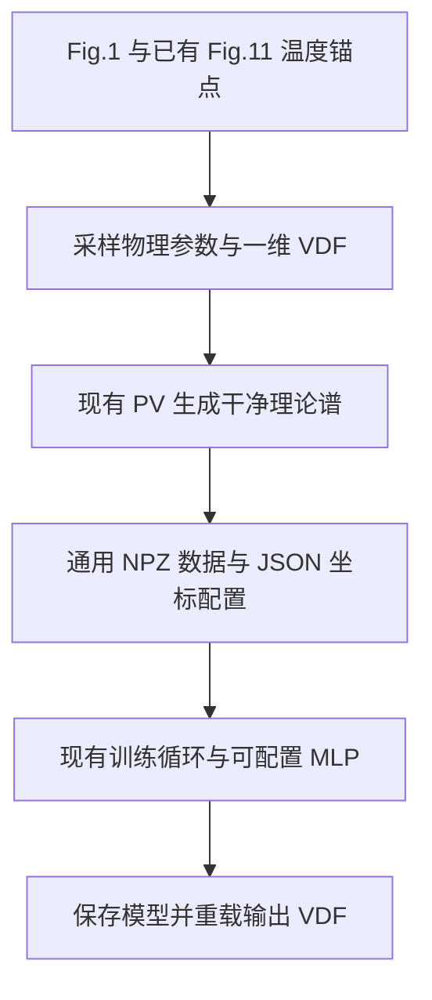

# SPEC：通用 VDF 模型与数据接口、球形腔干净训练数据

更新：2026-10-18。状态：设计，尚未实施。按用户要求经独立子 agent 范围审查及代码复用审查后修订。本轮只改文档，不修改代码，不生成正式数据或训练模型。

## 1. Requirements（需求）

只做两件事：

1. **通用模型和数据接口。** 现有 MLP、Fourier 标签和训练流程接受任意数量、种类及顺序的目标物种，以及任意数量、范围和点数的光谱段。一次训练的物种、坐标与维数固定，更换配置后重新训练。
2. **本任务专属数据生成。** 根据论文 Fig.1(a,b) 和已提取的 Fig.11 实验温度锚点，采样温度、密度、平均速度和分布形状，生成 e/H/C 的干净理论谱及对应 VDF，直接写成第一项接口能读取的训练数据，并接通现有训练循环。

“任意离子组分”指模型与数据接口可接受其他组分的数据；本任务内置生成器只负责 C5H12 的 e/H/C。现有 `OTS_spectrum_PV` 固定两个离子，本次不扩建通用多离子正向引擎。

不做实验/抠图数据反演、自动扣背景、mask、数据增强、敏感性分析、可辨识性报告、重复训练对照、新 CLI 或 registry。模型输入只有光谱，密度只是本任务的正向采样参数。保留现有任务、旧 Parquet 和旧 checkpoint 的行为。

完成标准是：本任务数据能够生成、保存、加载、训练、保存模型并重载预测；通用接口不把 e/H/C、319 点或 480 输出写死。这里的“跑通”是后续实施验收目标，不代表本轮已经执行。

## 2. Design（设计）

### 2.1 最小数据流与文件职责



| 文件 | 后续实施时的最小改动 |
|---|---|
| `vdf_data.py`（新增） | 普通字典配置、光谱拼接、NPZ/JSON 读写与 Fourier 标签 |
| `hohlraum_data.py`（新增） | 本任务锚点读取、VDF 采样、干净理论谱生成 |
| `model.py` | MLP 首末层维数、逐物种 Hermitian 投影、最小模型加载/预测接口 |
| `train.py` | 去除训练核心中的固定维数；增加一个数据到既有 `train_candidate` 的薄入口 |
| `data.py` | 仅为既有 `electron_moments` 增加质量参数；直接复用 `normalize_distribution` |
| `evaluation.py` | 仅参数化既有预测与逆 Fourier 数值函数；不增加评估业务流程 |

`main.py`、物理模块、旧 Parquet loader及现有 CLI 不改。新数据使用独立 NPZ。普通函数、字典、列表即可，不新增继承体系、任务注册、回调或插件机制。

复用边界：VDF归一化调用 `data.normalize_distribution`，矩计算调用增加质量参数后的 `data.electron_moments`；Fourier/PV直接使用现有函数；模型统计校验复用 `_validate_checkpoint_tensor`；预测/逆变换复用 `evaluation` 的数值函数；划分只保留一份索引算法。旧热电子采样范围、固定离子生成器和带背景的Maxwellian拟合不适合本任务，不硬套。NPZ读写与Fig.11筛选只保留必要适配。

### 2.2 通用数据与模型约定

配置 `contract` 仅包含：

| 字段 | 内容 |
|---|---|
| `bands` | 有序列表：`name, wavelength_nm`；每段至少2点、有限且严格递增 |
| `species` | 有序列表：`name, mass_kg, charge, v_grid_m_s, k_grid_s_m`；物种名称唯一，质量为正，各自速度轴固定、近似等间距且至少3点 |
| `fourier_modes` | 共同模式数 M，默认80；M为不小于2的整数且不超过任一速度轴点数 |

`species` 是网络实际输出的完整有序列表，可包含电子及任意离子；数据接口不判断这些物种应由哪个正向程序生成。电荷以基本电荷为单位，质量用 kg，速度用 m/s，Fourier K 用 s/m，波长用 nm。

令 `L=sum(len(band.wavelength_nm))`，`S=len(species)`：

- 输入维数 `D_in=L`，只拼接各段光谱；无 mask、密度或其他附加特征。
- 输出维数 `D_out=2*M*S`，第 s 块为 `[Re(F_s), Im(F_s)]`。
- 每段只做 `spectrum/max(abs(spectrum))`，保留整段相对峰高；不扣背景、不平滑。全零或非有限谱直接报错。
- 每种 VDF 在自己的固定速度轴上积分为1。K轴由现有 `ft_x_n` 生成，不能手写另一套 Fourier 约定。
- Hermitian 投影在每个物种的 M 个模式内执行，不跨物种翻转。
- 任意波段/物种指可配置，不是同一模型逐样本改变长度。模型保存这些坐标和顺序。

数据仅有两个同名文件：

- `dataset.npz`：`x[N,L]`、`y[N,2*M*S]`、`f_0[N,Nv_0]` … `f_{S-1}[N,Nv_{S-1}]`。x/y 为 float32，原始 VDF 为 float64。每行是一份独立物理样本，无 metadata 行、sample_id 或 group_id。
- `dataset.json`：`contract` 和 `sampling`。后者只记录本任务锚点、采样范围、几何、仪器参数及 seed；外部数据可留空。读取使用数组，不用 pickle 对象数组。

JSON坐标保存为普通列表，读回转为数组；x/y的数值一致性检查使用float32对应的容差。

本任务默认输入319点、输出 e/H/C 三组80复系数，即 **319 → 480**。更多波段直接增加 L，更多目标物种直接增加 S；无需修改网络定义。

### 2.3 Fig.1 与 Fig.11 锚点

论文：Hang Zhao et al., *Progress in optical Thomson scattering diagnostics for ICF gas-filled hohlraums*, [DOI:10.1063/1.5090971](https://doi.org/10.1063/1.5090971)。

| Fig.1 锚点 | 时间 ns | Te eV | 共同 Ti eV | ne cm^-3 | ui m/s | ue m/s |
|---|---:|---:|---:|---:|---:|---:|
| (a) | 2.0 | 209 | 78 | 3.5e20 | -640 | -1.4e5 |
| (b) | 4.3 | 1392 | 912 | 4.0e20 | 1.4e4 | -1.2e5 |

Fig.11 直接读取已有文件，不重新提取：

`<PROJECT_ROOT>/outputs/ots_experimental_fits/fig6_fig11_shared_ne6e20_20260921/paper_experimental_points.csv`

选择 `figure=fig11, shot_id=20170811020`，`parameter=T_e_ev` 的27点与 `parameter=T_i_ev` 的27点分别组成温度锚点池，使用 `point_id/value`。不把54个读数称为54组温度对，不读取旧拟合值作标签，不引入温度曲线提取任务。

每个样本均匀选择29个电子温度中心之一（Fig.1两点及Fig.11的27点）：选到Fig.1时采用同一点的 Ti 中心和密度范围；选到Fig.11时独立抽取其 Ti 池中的一个中心。后者用于温度范围采样，不保留时间配对关系。论文共同 Ti 作为 TH、TC 的共同中心，两种离子温度随后独立变化。

| 参数 | 变体采样规则 |
|---|---|
| Te | `max(20, Te0*exp(U(log(0.6),log(1.5))))` eV |
| TH、TC | 分别独立取 `max(10, Ti0*exp(U(log(0.5),log(1.8))))` eV |
| ne，Fig.1(a) | `U(0.8,1.2)*3.5e20` cm^-3 |
| ne，Fig.1(b) | `U(3,5)*1e20` cm^-3 |
| ne，Fig.11 | `U(2.8,5)*1e20` cm^-3；这是采样范围假设，不是各时刻密度测量 |
| uH、uC | 先抽公共 `ui~U(-2e4,3e4)`，再分别加 `U(-5e3,5e3)` m/s |
| ue | `U(-2.5e5,0.5e5)` m/s |

这些范围可通过本任务配置修改；它们是物理样本的变体范围，不是向光谱添加噪声或背景。

### 2.4 一维 VDF 与干净理论谱

输出是名义散射方向 `khat0=(ss-k_sh)/|ss-k_sh|` 上的一维实验室系 VDF。按用户决定，当前窄 IAW 窗口采用固定方向近似，不做三维投影、方向缓存或额外漂移几何对照。

每个物种独立抽取形状族：40% 单 Gaussian，40% 三 Gaussian 混合，20% 一维超高斯。

- 混合：归一化 Gaussian 的面积权重 `Dirichlet(2,2,2)`，中心 `U(-1,1)`，标准差 `U(0.7,1.4)`。
- 超高斯：直接定义一维 `exp(-|q|^p)`，`p~U(2,4)`；它不是三维各向同性超高斯的投影。归一化常数为 `p/(2*Gamma(1/p))`，方差为 `Gamma(3/p)/Gamma(1/p)`。
- 先将形状规范为零均值、单位方差 h，再在固定速度轴上求 `f(v)=h((v-u)/sigma)/sigma`，`sigma=sqrt(e*T/m_s)`，最后数值积分归一化。保存原始 VDF，同时用 `ft_x_n` 生成标签。
- 每物种默认4097点，区间 `±(max_abs_u+8*sqrt(e*T_max/m_s))`，由锚点及采样上界一次确定；不随样本改变网格。

本任务物理条件固定为：探针263.3 nm、散射角90°、H:C数目比12:5、Z_H=1、Z_C=6、质量使用现有模块的 `m_e,m_p,12*m_p`。准中性给出 `nH=(2/7)*ne, nC=(5/42)*ne`；PV参数 `N_i1/N_i2` 使用12/17和5/17，ne由cm^-3乘1e6转为m^-3。方向取 `k_sh=(1,0,0), ss=(0,1,0)`，`E_i0=(0,0,1)`，体积为 `(100e-6)^3 m^3`；归一化光谱不恢复绝对功率。

VDF均值已在f内，调用现有PV时三套外部漂移均为零。生成及Fourier计算显式float64。

默认波长轴沿用已提取Fig.10(b)的319点，端点262.31242236024843–264.2875776397516 nm；配置可指定其他轴。仪器只使用固定Gaussian FWHM=0.057 nm：在每段两侧多算 `8*sigma_lambda`，`sigma_lambda=FWHM/2.355`，内部等间距步长不大于0.002 nm；用单位面积核卷积后，直接插值到目标轴并整段归一化。不经过实验或图像的中间采样轴。卷积直接使用NumPy的 `convolve` 与离散权重和为1的Gaussian核；不另建卷积模块，也不套用旧拟合器在有限窗口逐行重归一的卷积以改变边界含义。

一份样本就是“一组物理参数和三套VDF → 一组干净理论谱”，不加入背景、随机幅度、噪声、色标误差、配准或缺测。所有形状和物理参数每行独立抽取，不建设基准形状缓存。

### 2.5 接通现有训练的最小改动

新增 `train_vdf` 仅负责加载NPZ、调用从旧函数抽出的 `split_indices` 做行级train/validation划分、计算统计和创建DataLoader，然后调用现有 `train_candidate`。旧 `split_train_validation` 也调用同一个索引函数，不再复制randperm/round/clamp逻辑。新入口不包含batch更新或epoch循环，也不复制优化器、调度和早停实现。复用现有 `run_epoch`、`coefficient_loss`、AdamW及早停逻辑，只把固定维数改成参数或从张量推导。

本任务一次配置一个网络，默认隐藏层1024×512、dropout=0；不新增候选搜索、多seed比较或独立评估流程。train/validation默认90%/10%，输入输出统计只用training部分。其余训练参数复用现有 `resolve_training_config`。

模型文件 `vdf_model.pt` 只保存：`model_state, hidden_sizes, dropout, contract, x_mean, x_scale, y_mean, y_scale, dtype, training_config, best_epoch, best_validation_loss, history`。dtype为本任务训练的float32，供既有预测函数读取。与旧 `model.pt` 分开加载；输入/输出维数从contract推导。预测只做原有反标准化、逐物种Hermitian投影和逆Fourier，不裁负、不额外拟合。

## 3. 具体接口与伪代码

以下仅列拟新增/修改的函数。其他函数接口保持不变；本节是后续实现说明，不是本轮代码变更。

### 3.1 `vdf_data.py`

**D1** `resolve_contract(bands: list[dict], species: list[dict], fourier_modes: int=80) -> dict`
```text
检查非空列表、唯一名称、波长轴、各物种质量/电荷与固定速度轴
对每种v调用ft_x_n(v, zeros_like(v), M)，取得K；若传入K则核对
返回只含bands/species/fourier_modes的普通字典；L/S及切片按列表长度推导
```

**D2** `pack_spectra(spectra: list[ndarray], contract: dict) -> ndarray`
```text
按bands顺序检查数量、各段最后一维长度及相同batch维；拒绝非有限或全零谱
每段沿最后一维除以max(abs(spectrum))，再沿最后一维拼接
返回[..., L]；不插值、不扣背景、不添加特征
```

**D3** `write_vdf_dataset(path: Path, spectra: list[ndarray], vdfs: list[ndarray], contract: dict, sampling: dict | None=None) -> None`
```text
拒绝覆盖已有文件；校验每段[N,L_b]和每物种[N,Nv_s]，样本数相同
检查VDF有限、非负且积分约1；x=D2(spectra,contract)
逐行逐物种调用ft_x_n，核对K并按[Re,Im]顺序拼接为y
保存NPZ的x/y及f_s；同名JSON保存contract和sampling
```

**D4** `load_vdf_dataset(path: Path) -> dict`
```text
读取同名JSON并用D1核对contract；np.load(...,allow_pickle=False)
检查x/y/f_s形状、finite、物种顺序与坐标；不猜旧Parquet格式
返回x/y的CPU float32 Tensor、VDF数组列表、contract及sampling
```

### 3.2 `hohlraum_data.py`

**H1** `load_hohlraum_anchors(points_csv: Path) -> dict`
```text
用标准库csv读取2.3指定Fig.11/shot/parameter的point_id和正温度value
得到Te/Ti两个非空列表，加入硬编码的Fig.1(a,b)两条精确记录
返回fig1、fig11_Te、fig11_Ti及来源路径；不做时间配对、提图或拟合
```

**H2** `sample_vdf(v: ndarray, mass_kg: float, temperature_ev: float, mean_m_s: float, rng: Generator) -> ndarray`
```text
按2.4概率抽形状；Gaussian混合解析求均值方差，超高斯用Gamma公式
把形状规范为h(z)；在传入的固定v上计算h((v-u)/sigma)/sigma
调用data.normalize_distribution(v,values,name)完成归一化与有限/非负检查
调用data.electron_moments(...,configured_ev=T,mass_kg=mass_kg)核对实际均值/温度
返回f的float64 ndarray；不再写第二套积分归一化或矩公式
```

**H3** `generate_hohlraum_sample(anchors: dict, contract: dict, config: dict, rng: Generator) -> tuple[list[ndarray], list[ndarray]]`
```text
确认本任务species顺序为e/H/C及对应质量/电荷；按2.3抽中心和Te/TH/TC/ne/u
逐物种用H2生成VDF；按2.4构造float64 PV参数，外部漂移全零
逐band调用既有OTS_spectrum_PV，用np.convolve及固定归一Gaussian核展宽后直接插值到目标轴
返回有序光谱列表与VDF列表；不生成任何观测扰动
```

**H4** `generate_hohlraum_dataset(points_csv: Path, output_path: Path, sample_count: int, seed: int, config: dict) -> dict`
```text
H1读取锚点；按采样上界确定固定v轴，配置bands及e/H/C后调用D1
建立rng(seed)，循环sample_count次H3；按band/species分别堆叠
D3保存数据，sampling记录锚点、采样参数、几何/仪器与seed
返回dataset_path及contract；不自动启动训练
```

### 3.3 `model.py`

**M1** `OTSRegressor.__init__(hidden_sizes, dropout, *, input_dim=1224, output_dim=160)`
```text
校验正整数维数；仅把现有首层/末层Linear的维数换成参数
LayerNorm/激活/初始化及state_dict名称保持原样；forward不变
```

**M2** `hermitian_project(coefficients: Tensor, *, fourier_modes: int=80) -> Tensor`
```text
要求末维为2*M的正整数倍；reshape为[..., S, 2, M]
各物种Re与翻转的Re平均，Im与翻转的Im反对称平均
恢复输入形状；默认160维的数值行为与旧函数一致
```

**M3** `load_vdf_checkpoint(path: Path, device: str='cpu') -> dict`
```text
加载本任务payload，D1核对contract并推导L及2MS
复用model._validate_checkpoint_tensor检查x/y统计量长度、finite与正scale
按隐藏层及推导维数构造M1，strict加载权重，eval
返回含model及原payload字段的字典；不改旧load_model_checkpoint
```

**M4** `predict_vdfs(loaded: dict, spectra: list[ndarray], contract: dict, *, batch_size: int=128) -> list[ndarray]`
```text
核对传入contract的物种/波段顺序及v/K/波长轴与模型一致；不只比较维数
spectra必须已位于这些轴上；D2拼接后转float32 Tensor，单条样本补batch维
函数内导入R2/R3以避免model/evaluation顶层循环导入
调用R3(model,x,loaded,batch_size,模型所在device,fourier_modes=M)
逐物种取2M系数块，调用R2(coeff_s,K_s,velocity=v_s)，转回ndarray
返回原始一维VDF列表；只提供数组接口，不读实验文件或生成报告
```

### 3.4 `train.py`

**T0** `split_indices(sample_count: int, fraction: float, seed: int) -> tuple[Tensor, Tensor]`
```text
原样承接旧split_train_validation的N/fraction/seed校验及局部Generator
randperm后以原round及上下限规则确定validation_count，返回train/validation索引
只移动既有算法，不改变随机数、舍入或排列顺序
```

**T0b** `split_train_validation(dataset, fraction, seed)`（签名不变）
```text
保留旧OTSDataset类型与validate_dataset校验
调用T0后索引旧spectra/coefficients，保持原四个张量返回值
```

**T1** `normalization_statistics(x_train, y_train)`（签名不变）
```text
保留二维、同样本数、非空及finite检查，移除1224/160限制
沿用现有逐列均值/std及scale下限，返回原四个统计量
```

**T2** `coefficient_loss(predicted_normalized, target_raw, y_mean, y_scale, raw_loss_weight, *, fourier_modes=80)`
```text
从末维检查预测/标签/统计量一致，不再要求160
反标准化后调用M2(...,fourier_modes=M)
沿用现有standardized MSE与normalized raw MSE公式及权重
```

**T3** `run_epoch(model, loader, optimizer, device, statistics, config, training, *, fourier_modes=80)`
```text
保留现有batch循环、反传、裁剪及样本加权loss
仅向T2传fourier_modes；不改变其他计算顺序
```

**T4** `train_candidate(hidden_sizes, train_loader, validation_loader, device, statistics, config, *, input_dim=1224, output_dim=160, fourier_modes=80)`
```text
按input_dim/output_dim构造M1；两次调用T3时传fourier_modes
复用现有优化器、调度、epoch循环、早停、最佳权重保存和返回值
```

**T5** `train_vdf(dataset_path: Path, output_dir: Path, config: dict) -> Path`
```text
D4读数据；复制config，未指定candidates时设为[{hidden_sizes:[1024,512],dropout:0.0}]
resolve_training_config解析配置，要求恰好一个网络配置及至少两条数据
沿用choose_device/set_determinism；调用T0做90/10或配置比例行划分
T1仅统计training部分；标准化x，创建现有形式的TensorDataset/DataLoader
T4训练一次，传L/2MS/M；取返回的最佳state_dict及best_epoch/best_validation_loss/history
创建输出目录并保存2.5所列payload到vdf_model.pt，已有文件则报错
返回checkpoint路径；函数内不写epoch/batch循环，不读取测试或实验数据
```

后续实施后，最小调用链为 `H4(...) -> T5(dataset_path, ...) -> M3(checkpoint) -> M4(loaded, spectra, contract)`。旧 `train_model` 仍通过T4训练，依靠默认参数保持原1224/160/80行为，无需重写旧入口。

### 3.5 复用的现有数值函数：仅补参数

**N1** `data.electron_moments(v_e, f_e, configured_ev, *, mass_kg=ELECTRON_MASS) -> dict`
```text
保留旧名称、归一积分、均值/中心方差及返回键；检查新增质量为正且有限
仅将温度式中的固定ELECTRON_MASS改为mass_kg，默认结果不变
H2按物种传质量；不通过速度缩放或修改configured_ev绕用电子质量
```

**R1** `evaluation._validate_k_grid(k_grid, *, mode_count=80) -> Tensor`
```text
复用原finite/递增/近似等间距检查；形状80改为传入的mode_count
要求mode_count为不小于2的整数；旧调用仍默认80
```

**R2** `evaluation.reconstruct_real_evdf(coefficients, k_grid, *, velocity=None) -> tuple[Tensor, Tensor]`
```text
未传velocity时保留原80模式检查与速度轴构造；传入时M=len(K)，调用R1(mode_count=M)
检查coefficients为[N,2M]，指定velocity为有限递增的一维Tensor
复用原cos/sin基底、梯形权重与矩阵乘法，仅把Re/Im切片80换成M
M=2时dk取K[1]-K[0]；其他情况保留原K[2]-K[1]，返回velocity及VDF
```

**R3** `evaluation.predict_coefficients(model, spectra, checkpoint, batch_size, device, *, fourier_modes=80) -> Tensor`
```text
输入/输出维数从checkpoint的x_mean/y_mean长度取得，代替1224/160检查
复用原dtype、batch循环、标准化、no_grad、反标准化及finite检查
调用hermitian_project时传fourier_modes；旧checkpoint行为不变
```

## 4. Tasks（任务拆解）

| 编号 | 任务 | 依赖 | 可验证结果 |
|---|---|---|---|
| 1 | 实现D1-D4通用数据接口 | 无 | 不同波段及物种数可写入、读回且坐标/列顺序一致 |
| 2 | 参数化M1/M2、T1-T4；抽出T0并复用到T0b | 无 | 任意L/S前向与loss可计算；旧划分及默认行为保持 |
| 3 | 实现H1-H4并复用归一化、参数化N1 | 1 | Fig.1/Fig.11变体得到干净谱、VDF及Fourier标签 |
| 4 | 参数化R1-R3并实现T5、M3/M4薄适配 | 1、2 | 数据直接接现有训练，可保存、重载并输出VDF |
| 5 | 完成下列最小验收 | 3、4 | 生成到重载预测的调用链实际跑通 |

## 5. Acceptance Criteria / Tests（验收标准）

1. **通用性**：至少检查单/双光谱段、两种不同总点数，以及S=1、3、4的合法数据；使用不同离子名称/质量/电荷。模型与数据函数不依赖H/C常量，各物种Hermitian投影不串块。同维数不同物种/坐标不能在加载数据或预测时被默认为同一配置。
2. **本任务数据**：复用已有27+27个Fig.11点及两条Fig.1记录；温度和密度采样符合2.3，TH/TC可独立变化。VDF归一化及实际矩与设定值在离散误差内一致；无背景、噪声、mask或图像处理分支。保存的y与保存VDF的Fourier变换一致。
3. **基本数值正确性**：用少量Gaussian样本对照现有解析Maxwellian谱；细化一次速度/波长网格确认理论谱稳定，并检查M=80的VDF往返误差。此项是普通数值验收，不建立pilot审批或报告体系。
4. **能跑通**：用小规模本任务数据完成加载、至少一次参数更新、validation、保存、重载及M4预测；loss有限，所有输出形状正确，重载前后的同批预测一致。不以未训练的设计文档宣称达到重建精度。
5. **兼容性与范围**：旧1224/160模型同权重预测、逆Fourier、默认电子矩及同seed划分保持不变；旧Parquet/checkpoint仍使用原接口。新增路径实际调用上述既有数值核心，不另写预测、逆变换、矩或划分算法。不修改现有物理公式，不添加实验反演、评估报告、CLI或registry流程。
