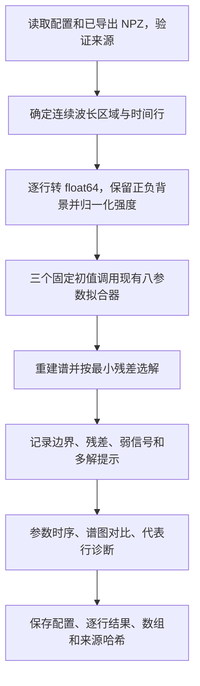

# SPEC：三组实验 OTS 时序谱的八参数拟合

日期：2026-09-14；更新：2026-09-15。状态：T1–T3 已实施，15 行 pilot 及授权的改进对照已完成；T4 报告已更新供用户审查，未运行 full。

## 1. Requirements（需求）

### 1.1 目标与范围

从三份已导出的时间—波长二维强度矩阵中，逐时间行拟合等离子体参数，输出参数随 FIG 时间的变化、拟合谱及残差、每行质量标记。

用户已明确选择两种离子温度独立：拟合 `Te、TH、TC、uik、uek、A、B1、B2`，沿用现有八参数拟合器。研究者应能检查某一时间行的实测谱、拟合谱、参数及其来源，区分可用结果、弱信号和不稳定解。

本次新增独立实验分析脚本，读取完整 NPZ 后在内存中逐行分析；不向提取器增加切片功能，不修改 `extract_ots_data.py`、现有 quicklook、原始 FIG、`spectral_fitting.py` 或物理模块。原始导出数据保持不变。第一版不做时域平均、平滑、全时间联合拟合或神经网络反演。

### 1.2 参考文章与事实来源

用户所称 `exp_params` 按当前目录中的 `OTS_data/exp_ref_para.pdf` 处理：Zhao et al., *Progress in optical Thomson scattering diagnostics for ICF gas-filled hohlraums*, Matter and Radiation at Extremes 4, 055201 (2019)，DOI `10.1063/1.5090971`。当前未发现名为 exp_params 的文件。

以下页码是包含封面的 PDF 物理页码；印刷页码比它少 1。

| 依据 | 本次采用方式 |
|---|---|
| PDF p4，II.B，式(5)–(9) | Maxwellian 电子和离子的无碰撞、无磁正向模型；两离子组分分别参与响应 |
| PDF p4，式(10) | 归一化理论信号乘幅度 A，再加两端值为 B1/B2 的线性背景；最小化无权残差平方和 |
| PDF p4，II.B | 电子密度、电荷态为给定条件；每个光谱样本来自一个原始时间像素 |
| PDF p4–5，Fig.1 | 以 R 与局部 Delta R 图观察拟合质量和参数敏感性；±100 ps 邻近样本的散布不等于时间平均 |
| PDF p6–7，Fig.4/5 | 圆柱腔、C5H12、263.3 nm、90°；充气完全电离基准 ne=6e20 cm^-3，光谱 FWHM=0.065 nm |
| PDF p9–10，Fig.8/10 | 球形腔、C5H12、4ω 探针、90°；充气完全电离基准 ne≈3.5e20 cm^-3，光谱 FWHM=0.057 nm |

论文式(10)用共同 Ti 共七个参数；本任务按用户选择扩展为 TH/TC 独立的八参数，不能称为严格重复论文七参数结果。论文还讨论梯度和 k 展宽，本版不加入这些项。

### 1.3 当前数据与物理条件

本轮现场确认实际数据入口为 `OTS_data/ots_data_extracted/`，已存在三个 shot 的 `ordered_arrays.npz`、`metadata.json` 及总 manifest。三个 NPZ 均已与 manifest 的 SHA-256 对照一致。manifest 记录的历史绝对输出路径仍指向 `outputs/.../20260914_quicklook`；读取必须以当前输入目录和 manifest 相对文件名为准。

| shot | 矩阵 | 第一版波长范围 / nm | 第一版 FIG 时间范围 / ns | 入选行数 | 入选波长点数 | FWHM / nm |
|---|---|---|---|---:|---:|---:|
| 20160909153 | 1024×1344，float64 | 261.3–265.3 | -0.5–2.5 | 555 | 925 | 0.065 |
| 20160919163 | 1024×1344，float64 | 261.3–265.3 | -0.5–2.5 | 555 | 925 | 0.065 |
| 20170811020 | 1024×1344，uint16 | 261.3–265.3 | 0–3.5 | 649 | 1053 | 0.057 |

上述范围采用 FIG 原显示范围作为第一版分析区域，是工程起点而非全部有效信号区；总计 1,759 行，时间步长 0.0054 ns。保留每行质量结果，不能把这 1,759 行都预先称为有效等离子体测量。需要扩大时间范围时显式修改配置，原始完整矩阵始终保留。

统一模型条件：探针 263.3 nm，散射角 90°；完全电离 C5H12 假设，H:C 数目比 12:5，`ZH=1、ZC=6`，质量沿用现有拟合器的 1/12 amu。两离子共用 uik，电子用 uek；温度单位 eV，速度单位 cm/s，密度单位 cm^-3。

密度必须在运行配置中显式写入，不由拟合器同时反演。建议首次参考试算为：2016 两 shot 固定 6e20，2017 固定 3.5e20 cm^-3，标记 `density_basis=fill_reference_assumption`；这不是已确认的体元逐时刻密度。若获得模拟/实验密度，配置可提供按原始行号对齐的正值数组，禁止隐式插值。

论文 Fig.1(a)/(b)/(c) 给定的密度分别为 3.5e20、4.0e20、1.0e21 cm^-3，尤其说明不可用充气密度替代全部时刻的条件。固定密度试算得到的是条件性参数曲线；要作论文定量比较，必须补齐对应时刻的密度来源。

保留 `time_fig_ns`。Fig.5/10 的 shot 对应及 +0.5/+1.5 ns 时间偏移仍是候选，本版不应用偏移、不输出伪装已校准的论文时间。

## 2. Design（设计）

### 2.1 最小实现结构

新增一个 `fit_ots_experiments.py`，与 `spectral_fitting.py` 同目录。使用普通函数、dict、NumPy 数组和现有 SciPy/PyTorch/Matplotlib，不引入类层次、数据库、任务调度或并行框架。

只复用现有：

- `spectral_fitting.fit_spectrum(...)`：单条光谱的八参数有界优化。
- `spectral_fitting._fit_model(...)`：用返回参数重建拟合谱并计算残差；本地分析脚本允许调用这个既有内部函数，记录源码哈希，不另抄物理公式或新增公共 API。
- `spectral_fitting.plot_fit_result(...)`：仅对少量代表性行生成 Te–TH、Te–TC 的 Delta R 图。实验数据不传 `true_result`。

每个时间行独立拟合，不将前一行解作为下一行唯一初值，不施加时间平滑约束。先做少量代表行的试运行，验证方法和耗时，再覆盖配置中的全部行。

本轮读取的解析正向源码对入射/散射光均使用介质内波数，采用 `k=ks-ki`、`omega_shift=omega_s-omega_i`。已有审计 SPEC 的历史文字不能覆盖当前源码；运行时记录实际源码哈希，并用已知正负漂移的合成谱核对速度方向。



### 2.2 测量谱准备与归一化

对选定时间行 i 和连续波长区域：

```text
I = intensity[i, selected_columns].astype(float64)
scale = max(abs(I))
y = I / scale
```

这里的归一化指光谱相对强度；保存每行在所选波长区域内计算的 `scale`，它是由实验数据确定的归一化记录，不是新增拟合参数。信号幅度由 A 表达，背景由 B1/B2 表达。物理电子密度 ne 仍是给定条件，不能用 A 替代它对谱形的影响。

要求 I 全部 finite，且 scale>0；否则记 `invalid_input`。保留 scale、原始行号/列号、FIG 时间和实际波长端点。全零谱保存 scale=0，不执行除法；非有限输入的 scale 在 JSON 中为 null、NPZ 中为 NaN。有效输入即使后续拟合失败，也保留已计算的 scale。uint16 必须先转 float64，防止后续残差运算溢出。

不减去最小值、不扣除全局中位数、不截负值、不平滑实测谱。归一化保留正负号：2017 的正基底与 2016 的负背景均由允许正负取值的 B1/B2 拟合。负背景本身不构成异常，不通过平移数据或强制 B≥0 来处理。

模型采用同一连续均匀波长网格。首版不删除中间的“坏点”，避免破坏现有 `_gaussian_convolve` 等点权重假设。明显杂散光污染的行标记待复核；未来需要像素 mask 时，应独立设计“完整网格建模/卷积后再计算 mask 残差”，不直接把有孔波长数组传给现有拟合器。

### 2.3 模型、目标与参数边界

```text
q = (Te, TH, TC, uik, uek, A, B1, B2)
fitted(lambda) = A * S_broadened_normalized(lambda; Te,TH,TC,uik,uek,ne)
                 + B1 + (B2-B1)*(lambda-lambda_left)/(lambda_right-lambda_left)
SSE = sum((fitted-y)^2)
R = sqrt(SSE/N) / A
```

Gaussian 仪器卷积使用各 shot FWHM，卷积后信号按峰值归一；A 表达归一化测量谱中的信号幅度，B1/B2 是同一相对强度单位下、选定波长区域两端的有符号背景值。ne、组分、波长、角度和 FWHM 均为给定条件。`uek-uik` 可另存为电子相对离子漂移，不把 uek 本身误写成该差值。

按本轮现场读取的 `spectral_fitting.py` 更新边界，优化设置保持不变：

| 参数 | 下界 | 上界 |
|---|---:|---:|
| Te / eV | 10 | 5000 |
| TH、TC / eV | 10 | 6000 |
| uik / cm/s | -1.5e8 | 1.5e8 |
| uek / cm/s | -3e8 | 3e8 |
| A | 0 | 10 |
| B1、B2 | -2 | 2 |

现有实现为 `least_squares(method='trf', x_scale='jac', max_nfev=2000)`，无权最小二乘。返回参数字典或抛异常，不返回完整 OptimizeResult；本版记录每次调用成功/异常及实际耗时，不虚构 nfev、Jacobian 或协方差。

拟合结果、实测谱、重建谱及残差统一使用归一化相对强度，不做额外幅度换算。边界取当前源码值，不自动扩大边界或修改拟合器。

保存的 scale 供后续恢复原生强度使用：有效行满足 `I = scale*y`，拟合谱及 A/B1/B2 也可乘同一行 scale 得到原生强度单位。当前拟合、绘图和谱数组输出仍保持归一化形式，不额外生成回乘数组。

### 2.4 初值、选解与质量标记

每行默认三个确定性温度初值（Te,TH,TC，eV）：`(200,80,120)`、`(1200,600,900)`、`(2500,2200,3300)`；每组 uik/uek 起点为 0。

背景初值取归一化谱 y 首尾各 10% 点的中位数，保留符号；仅为满足优化器严格内点要求，将 B1/B2 初值限制在 `[-2+1e-4, 2-1e-4]`。A 初值取 y 峰值减两端背景均值，限制在 `[1e-4, 10-1e-4]`。这些操作只设置初值，不改动测量谱，也不限制最终参数必须为内点；端部估计不能当作已知无信号区或正式暗场。

分别调用三次 `fit_spectrum`，保存全部初值、成功/失败原因和成功候选参数，用 `_fit_model` 在同一网格计算 SSE。选择有限且 SSE 最小的成功候选；全部失败则 `fit_failed`。三初值只能减轻局部最优问题，不能证明全局唯一。

记录质量指标与状态：

- `R`、SSE、残差均值、残差标准差、A、各参数到边界的相对距离。
- A≤1e-8 时 R 记 null 并标 `negligible_amplitude`，不得输出无穷值。
- 任一参数距其边界不足全范围的 0.1%：`at_bound`。
- R>0.2：`large_residual`。0.2 是首版工程复核阈值，写入配置，不是论文的可信度判据。
- 若其他成功候选 SSE≤1.01×最佳 SSE+1e-12，且任一温度差超过最佳温度的 20%：`nonunique_temperature`；这是有限候选间的不稳定提示，不是置信区间。
- A 小于三倍残差标准差：`weak_signal`，仅为模型相关的初筛，不等同仪器实测 SNR。
- B1/B2 为负本身不触发质量警示；只有碰边界、残差等既有指标提示问题时才进入复核。

状态为 `ok`、`review`、`invalid_input`、`fit_failed`。成功解带任一警示为 review，仍保存数值和谱，不静默丢行。异常/无效行参数记 null，图中留空；review 行使用不同标记，不能与 ok 连成不加区分的“可信曲线”。初版图表还应人工检查结构性残差和杂散光，低 SSE 本身不能保证物理正确。

不强行拟合：输入无效或全部初值失败时保留相应状态；弱信号、边界解和不稳定解保留复核标记，不通过增加幅度因子、扣背景、截负值、扩大边界或反复重试来凑出 ok 结果。

### 2.5 试运行与不确定性边界

试运行每 shot 从配置时间区间按行号等间距选 5 行，共 15 行，三初值共 45 次优化上限；同一实际行只计一次。用途是核对数值尺度、模型范围、失败处理和实际耗时，不按试运行结果挑出“最好看的”时间段。

完整模式按步长 1 覆盖 1,759 行，最多 5,277 次现有优化调用。先依据试运行的实测耗时估算，不预先承诺运行时间。当前 Gaussian 卷积每次调用会构造 N×N 核，可能耗时较高；本 SPEC 不顺便重构该实现。

代表行诊断选每 shot 的 ok 行中按时间等间距最多 3 行，共最多 9 行。复用现有 `plot_fit_result` 生成谱对比与两个 Delta R 平面；其他六参数固定，因此这些图是局部敏感性图，不是 profile likelihood 或 8 维联合置信区间。不得沿用论文共同 Ti 的误差百分比作为 TH、TC 各自误差。

本版不提供自动统计置信区间，不把 ±100 ps 参数变化直接解释为纯统计噪声。若双离子温度不可分辨，报告有限初值比较和敏感性图证据，不能强行把两条温度曲线解释为独立测量成功。

### 2.6 输入配置与输出

建议配置为普通 JSON，包含：`input_dir`、`output_dir`、`mode=pilot/full`、共同物理条件、上述初值和质量阈值，以及每 shot 的 ID、time_range_fig_ns、wavelength_range_nm、instrument_fwhm_nm、density_basis、electron_density_cm3。密度可为单个常数或长度 1024 的原始行顺序数组，二者不得混用。缺少密度或来源描述时在启动前报错，未知条件不隐式沿用拟合器默认值。

```text
outputs/ots_experimental_fits/<run_name>/
├── config.json                 实际执行配置
├── manifest.json               来源/代码哈希、环境、任务状态、各状态数量
└── <shot_id>/
    ├── fit_results.json         每个目标行的 scale、参数、初值候选、指标和状态
    ├── fitted_spectra.npz       波长、时间、源索引、每行 scale、归一化实测/拟合/残差矩阵、有效掩码
    ├── overview.png            实测二维谱、拟合二维谱、残差二维谱
    ├── parameters_vs_time.png  Te/TH/TC、uik/uek、R 随 FIG 时间变化
    ├── pilot_spectra.png       pilot 的全部五行实测/拟合/残差对照，供停点审查
    └── diagnostics/            最多三份代表行 Delta R 三联图
```

NPZ 强度保存归一化相对单位：`measured_normalized=y`、`fitted_normalized=fitted`、`residual_normalized=fitted-y`，另存一维 `scale`，长度等于目标行数，并与 FIG 时间、源行号及谱矩阵行顺序严格对齐。`fit_results.json` 每行也保存同一 scale；不输出恢复原生强度的派生数组，原始值可由输入 NPZ 和源索引追溯。失败行的拟合/残差使用 NaN，并有显式 `fit_valid` 布尔掩码；只有掩码为真的行要求有限。JSON 使用 null，不写 NaN。归一化实测/拟合谱共享色标，残差用以零为中心的独立对称色标；色标仅显示，不改变数据。

manifest 区分 `completed`（全部目标行均已处理，包括被标为无效或拟合失败的行）与 `failed`（数据/配置/文件输出等系统故障），并必须列出四类行状态计数。零个 ok 行时明确写出，不宣称物理参数已可靠测得。输出必须新建目录，输入 NPZ/metadata/FIG 保持不变。

## 3. 具体函数接口与伪代码

新增脚本限以下七个普通函数；参数以 dict 和 NumPy 数组传递。现有被调用函数保持原签名和实现。

### F1. `load_config(path: Path) -> dict`

```text
读取 JSON，校验输入目录、三个 shot ID、新输出目录及 mode
校验每 shot 的时间/波长范围、FWHM、正密度及其来源
校验三组初值严格位于现有边界内，阈值有限且在合法范围
要求密度数组长度 1024 且按原始行号索引
返回完整显式配置，不补入未注明的物理假设
```

### F2. `load_shot(input_dir: Path, shot_id: str, settings: dict) -> dict`

```text
从当前 input_dir 定位 manifest 相对路径，拒绝越出输入目录
核对 NPZ 与 metadata 哈希并读取 allow_pickle=False 数据
验证 shape=(1024,1344)、有限值、轴递增、波长近似均匀、源索引合法
按闭区间选连续波长列与目标时间行；空区间或请求越界报错
pilot 时从目标行等间距选最多 5 行；full 保留全部目标行
将密度按 source_row_index 映射到目标行，保存源索引和输入哈希
返回数组及各行的明确物理条件，不修改或重写导出文件
```

### F3. `prepare_row(data: dict, row_index: int) -> dict`

```text
读取指定目标行和波长列，转 float64
检查 I 全部 finite；非有限则 scale=null 并返回 invalid_input
计算并保存 scale=max(abs(I))；scale=0 时返回 invalid_input，不执行除法
计算 y=I/scale，保留 scale、FIG 时间、源行列号
按 y 首尾各 10% 点中位数构造有符号 B1/B2 初值，构造 A 初值
仅将初值限制在当前边界内：B 为 [-2+1e-4,2-1e-4]，A 为 [1e-4,10-1e-4]
不修改 y 或强制背景非负；生成三组完整八参数初值
返回拟合输入和追溯信息
```

### F4. `fit_row(row: dict, physics: dict, thresholds: dict) -> dict`

```text
invalid_input 直接返回状态，参数 null
对三初值逐个调用现有 fit_spectrum，记录耗时与异常
将成功候选按 (Te,TH,TC,uik,uek,A,B1,B2) 顺序传给现有 _fit_model，重建同网格谱并计算 SSE
选择 SSE 最小的有限候选；无成功候选则 fit_failed
计算 R、残差指标、边界距离和多候选温度分歧
生成弱信号/大残差/边界/多解等标记，确定 ok 或 review
返回该行 scale、八参数、归一化拟合谱/残差、所有候选和质量信息；失败分支也保留 scale，不强行修复失败或复核结果
```

### F5. `plot_shot(data: dict, results: list[dict], output_dir: Path) -> None`

```text
按 FIG 时间绘制实测/拟合/残差二维图，失败行明确留空
pilot 二维图使用五个明确标注时间的离散行，不插值成完整时序；另绘全部五行谱对照
归一化实测与拟合共用色标，残差使用独立零对称色标
绘制三温度、两速度与 R 时间曲线，区分 ok/review，失败行断开
从 ok 行按时间等间距选最多三行
调用现有 plot_fit_result，传归一化实测谱和归一化幅度背景，不传 true_result
诊断图标明固定密度、独立 TH/TC 和“局部敏感性，非联合置信区间”
```

### F6. `write_results(output_dir: Path, config: dict, data: dict, results: list[dict]) -> dict`

```text
创建新 shot 目录；要求每个目标行恰好一个结果，源行号不重复
写标准 JSON：逐行保存 scale，非法参数/指标为 null，并保存候选与异常
写 NPZ：每行 scale、归一化实测/拟合/残差、源索引、FIG 时间和 fit_valid
调用 plot_shot；回读验证 scale 与行号对齐、JSON/NPZ 一致、有效行 finite 和 residual=fitted-measured
对输入有效行核对 scale*y 与原始输入在浮点容差内一致
计算产物哈希及各状态数量，返回 manifest 所需的 shot 摘要
```

### F7. `main(argv: list[str] | None = None) -> int`

```text
解析 --config，load_config；记录 PDF/输入/现有拟合及正向源码哈希
新建输出根目录并写实际配置、running 状态
依次处理三个 shot：load_shot → prepare_row → fit_row → write_results
遇到单行拟合失败记录并继续；配置/输入/输出系统错误终止并标 failed
复核输入文件哈希未变化，统计每种行状态，记录实际耗时和执行环境
全部目标行处理完成则标 completed；以状态数量说明物理结果可用程度
```

## 4. Tasks（任务拆解）

| 编号 | 任务 | 依赖 | 验收产物 | 状态 |
|---|---|---|---|---|
| T0 | 核实论文、数据位置、数组和当前拟合接口 | 无 | 本 SPEC 与已核验的三个 NPZ 哈希 | 已完成 |
| T1 | 明确首轮密度假设并编写配置，实施 F1–F3 | T0 | 输入/单位/源索引检查、三组初值 | 已完成 |
| T2 | 实施 F4，验证无噪声闭环及失败标记 | T1 | 拟合/重建使用同一模型和单位 | 已完成 |
| T3 | 实施 F5–F7，完成 15 行 pilot | T2 | 参数、残差、质量状态、耗时及诊断图 | 已完成 |
| T4 | 审核 pilot 的结构性残差和不可辨识性 | T3 | 问题行列表，必要的配置调整及依据 | 授权改进与对照已完成，更新报告供用户审查 |
| T5 | 覆盖配置中 1,759 行并验收 | T4 | 完整三 shot 时序结果与成功/复核/失败计数 | 未运行，等待 T4 |

如果 pilot 暴露边界或背景模型无法适配，先报告具体问题，再针对性设计修改；不能擅自改变现有拟合器或通过删数据制造好看的结果。

## 5. Acceptance Criteria / Tests（验收标准）

1. **来源**：所有结果可追溯到输入 NPZ 哈希、原始行列索引、FIG 时间、密度值及来源、FWHM 和源码版本；输入哈希未变化。
2. **八参数**：TH 与 TC 分别传给 H/C，不交换物种、不暗中强制相等；uik/uek 含义、cm/s→m/s 和 cm^-3→m^-3 与现有模型一致。
3. **归一化与背景**：uint16 转 float64 后处理，scale=max(abs(I))、y=I/scale 保留正负号；逐行 scale 在 JSON 与 NPZ 中一致且与源行号对齐，输入有效行的 scale*y 在浮点容差内恢复原始值。全零/非有限输入不执行归一化，拟合失败不丢失有效输入的 scale。A 表达相对信号幅度，B1/B2 可为负；scale 不参加优化，归一化残差与独立重算一致。
4. **接口闭环**：至少低温、中温、高温三组合成无噪声谱，TH≠TC、允许非零漂移，并覆盖负 B1/B2。归一化后 A/B 使用同一相对强度定义；用包含真值附近初值的调用验证谱 relative L2<1e-5。另检查 A 上界 10 与 B 下界 -2 的接口合同；它验证接口与数值一致性，不作为实验唯一性证明。
5. **异常合同**：零谱/非有限输入、缺失密度、非均匀网格、错哈希、越界范围、优化异常有明确状态；全部候选失败不生成虚假参数。
6. **候选和边界**：保存全部三初值结果，按同一网格 SSE 选最优；采用源码当前 A∈[0,10]、B1/B2∈[-2,2]。边界解、大残差、微小 A 与相近 SSE 的不同温度解均能触发标记；负背景本身不触发异常，不改数据或放宽边界强行取得 ok。
7. **图表**：实验/拟合同色标，残差独立零对称色标；ok/review/失败可区分；Delta R 不标成联合置信区间。
8. **覆盖**：full 模式下目标 555/555/649 行各有一个结果，不静默跳过；四种状态数量之和等于目标行数。算法跑完不等于每行都物理可信。
9. **执行边界**：不改提取器、已导出文件、现有拟合器或正向物理代码；不将结果写入 canonical 数据集/模型 registry。

2026-09-14 pilot 实施记录：新增七函数独立脚本 `fit_ots_experiments.py`，实际配置为本目录 `ots_experimental_pilot_config.json`。首轮显式采用充气完全电离基准假设：2016 两图 `6e20 cm^-3`、2017 图 `3.5e20 cm^-3`，均标为 `fill_reference_assumption`，不作为已知逐时刻局部密度。输出为仓库根下 `outputs/ots_experimental_fits/pilot_20260914/`，审查入口为其中 `PILOT_REVIEW.md`。

三图各 5 行、每行 3 个候选均返回有限结果；按 shot 顺序 ok/review 分别为 3/2、1/4、3/2，总计 7/8，invalid_input/fit_failed 均为 0。总耗时约 301 秒。原始行号、scale 回乘、JSON/NPZ 一致性、残差、候选选择及 22 个输出哈希通过独立回读验证。三组合成闭环最大光谱 relative L2 为 `2.71e-11`；异常输入、优化失败、范围/网格/哈希拒绝检查通过。实际依赖及源码/输入哈希保存在运行 manifest。

待审问题包括电子漂移与温度触边、弱信号下相近 SSE 的不同温度解，以及部分 ok 行仍存在结构性残差。ok 仅表示未触发首版质量规则；NPZ 的 fit_valid 同时包含 ok/review，仅表示有限拟合结果。没有调整边界、删点或更换时刻来消除标记，未改既有提取器、拟合器、物理代码或实验数据。用户审查前不进入 full。

2026-09-15 后续记录：按用户“尽最大可能改进pilot并解释review”执行`SPEC_OTS_PILOT_IMPROVEMENT.md`，新增独立`improve_ots_pilot.py`，原pilot保留。完成71个受控案例/1211候选；原15行同条件SSE均不高于基线，自动6 ok/9 review，新增的一条来自发现温度多解。论文对应三样本在共同Ti对照下Te偏差均小于1%、Ti最大7.53%；TH/TC独立仍为主模型。波长/时间偏移只标为发表图像配准推断，未修改源坐标或默认配置。审查入口更新为仓库根`outputs/ots_experimental_fits/pilot_improved_20260915/IMPROVEMENT_REPORT.md`，包含8条原review逐行原因、完整谱对照与验证；1759行full仍未运行。
