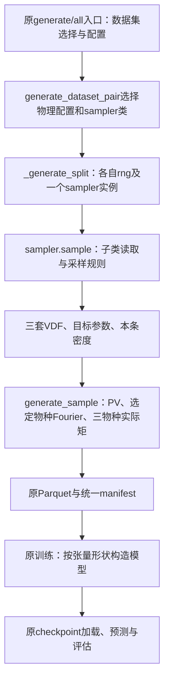

# SPEC：接入 Fig.1/Fig.11 数据集及可配置输入输出

日期：2026-10-19。状态：设计，尚未实施。本轮不修改代码。

## 1. Requirements（需求）

在已修复的 fixed_ion 调用链中接入 `Fig1_Fig11_sampler`，继续使用 `data.py`、现有 Parquet、模型和训练流程。

1. 光谱段的数量、波长范围和点数可配置；电子、离子1、离子2的速度轴和点数分别可配置。一份数据集内坐标固定，不做逐样本变长或padding。
2. 使用用户已有的 `used_in_model` 布尔标志选择输出物种。固定顺序为e、i1、i2，选择任意非空子集。输出的是各物种的复Fourier系数，K是对应坐标，不是把K坐标本身当作预测标签。
3. 从实际数据张量形状确定MLP首末层维数；模型、loss、checkpoint、预测和评估同步适配。
4. 增加独立的 `_physical_config_fig1_fig11`。保留 `_physical_config` 作为fixed_ion配置，不把两套物理条件混在一个函数内。
5. 每条样本对三个物种平等记录期望温度、期望均速、实际温度、实际均速，无论该物种是否选为输出。
6. **期望值是事先希望生成的目标，实际值是生成后分布的性质。** 解析计算和数值积分都是求实际值的方法；不得把实际值反填为期望值。
7. anchor文件读取、筛选、锚点选择及其附近参数采样全部是第二个sampler的子类方法。外层只选择配置/子类、调用统一采样接口、生成谱和标签、记录返回值。

用户故事：选择数据集及输出粒子后，沿原命令生成数据；训练读取数据后自动匹配输入输出长度；在manifest中按同一结构查看所有粒子的设定目标与实际结果。

只做本次接入。不新增数据模块、NPZ训练格式、训练循环、插件/工厂/注册机制，不处理实验谱、不重新提图、不添加噪声/背景/mask。正向仍使用现有双离子PV，三种物理分布始终参与正向；未选中输出不等于删除对应物种。

## 2. Design（设计）

### 2.1 当前源码与改动边界

当前 `data.py` 已有sampler、固定网格及原调用链，且用户新增了三个 `*_dis.used_in_model` 字段。主要缺口为：外层写死Fixed子类，维数及电子标签硬编码；只有电子矩记录；训练/checkpoint/evaluation固定1224/160/80。已有PV、Fourier、归一化、优化器、划分及文件写入直接复用。



只有 `generate_dataset_pair` 有两分支选择：fixed_ion对应 `_physical_config/Fixed_ion_sampler`，fig1_fig11对应 `_physical_config_fig1_fig11/Fig1_Fig11_sampler`。`_generate_split`接收类并实例化；样本循环内没有dataset/figure/anchor分支。以后增加同接口子类，只增加入口选择及其配置，不改样本循环。

### 2.2 静态配置、数据布局与维数

两套物理配置返回相同结构的普通dict，几何和PV所需标量保留；统一布局包含：

| 字段 | 约定 |
|---|---|
| `fourier_modes` | 各目标共同M，默认80，整数且3≤M≤三套速度轴的最小点数；未选中物种也须满足现有PV的参数验证 |
| `wavelength_bands_nm` | 有序波长数组列表；每段至少2点，有限、严格递增；允许不等间距 |
| `electron_dis/ion1_dis/ion2_dis` | 各自 `name, mass_kg, charge, velocity_grid_m_s, used_in_model` |
| 各物种的 `expected_temperature_ev/expected_mean_velocity_m_s` | 配置中的默认目标；子类可为每个样本重新采样目标 |

速度轴一维、finite、严格递增、近似等间距、至少3点，单位m/s；计算为float64。沿用三个现有 `*_dis` 名称及 `used_in_model` 语义，不另加一套输出选择配置。构造配置时生成坐标；sampler将其转换为Tensor。JSON写普通列表，不能保存Tensor对象。

新增小函数 `dataset_layout(physical_config)` 从上述字段提取波长、物种身份/速度轴/选择标志及M，作为dataset/checkpoint的布局信息，不复制采样器、anchor或逐样本记录。由同一份配置派生，禁止独立维护第二套坐标或选择标志。

`L=sum(各段点数)`，`S=sum(used_in_model)`，输入L，输出`2*M*S`。按e/i1/i2筛选后的顺序逐物种拼接 `[Re(F_s),Im(F_s)]`。输入输出维数最终由加载后的`x.shape[1] / y.shape[1]`取得，并与布局推导值交叉检查。速度点数Nv不等于Fourier模式数M，改Nv不会自动改变标签长度。

fixed_ion默认保留三段579/304/341、三套1000点速度轴、只输出电子，即1224→160。第二套默认一段319点、三套4097点速度轴、输出e/H/C，即319→480。允许例如只输出H/C得到319→320，或只输出C得到319→160。

### 2.3 sampler：一次样本统一产生参数与分布

基类统一持有 `rng, physical_config`。将当前构造参数收拢为这两项，仍使用已有的三个 `sample_*_vdf` 方法。新增统一 `sample()`：先调用一次子类 `sample_parameters()`，再生成三套VDF，返回普通dict：

```text
{
  "distributions": {"e": (v_e,f_e), "i1": (v_i1,f_i1), "i2": (v_i2,f_i2)},
  "expected": {
    "e":  {"temperature_ev": ..., "mean_velocity_m_s": ...},
    "i1": {"temperature_ev": ..., "mean_velocity_m_s": ...},
    "i2": {"temperature_ev": ..., "mean_velocity_m_s": ...}
  },
  "electron_density_m3": ...
}
```

`sample()`每次重建本条参数，三个分布方法只使用这一条参数，不各自重新抽anchor。返回目标值来自 `sample_parameters()`，在生成VDF前确定。实际矩统一由外层从返回v/f计算，不由子类把目标直接冒充实际值。

Fixed子类目标默认为Te=1370 eV、TH=TC=171.3 eV、三个均速为0。原电子三背景加弱热Gaussian的算法和随机数消耗不变，**不会为了满足记录的目标而重新缩放**；其实际Te/u通常不等于目标。离子仍为原固定Maxwellian。1370的历史参考温度与现在明确记录的目标数值相同，但目标记录不意味着旧算法曾保证达到它。

第二个子类在 `__init__` 调自己的 `load_anchors()`，每split读取一次；在 `sample_parameters()` 中处理anchor及邻域采样。外层不接触CSV列名、Fig.1/Fig.11、温度池或锚点数量。

### 2.4 第二个数据集的物理条件与子类采样

复用已提取CSV，不重新提取：

`C:/Users/win/.codex/worktrees/74c1/ots/outputs/ots_experimental_fits/fig6_fig11_shared_ne6e20_20260921/paper_experimental_points.csv`

子类选 `figure=fig11, shot_id=20170811020`，读取27个 `T_e_ev` 和27个 `T_i_ev`。2026-10-19现场核对范围分别为148.81–1617.97、67.10–897.55 eV。Fig.1(a,b)精确锚点Te/Ti分别209/78与1392/912 eV，密度分别3.5e20与4.0e20 cm^-3，仍由子类加载方法组织。

沿用此前讨论的变体范围作为本次初始配置：

- 均匀抽取29个Te中心之一；Fig.1使用同条Ti中心，Fig.11独立抽一个Ti中心，不声称时间配对。
- Te=`max(20,Te0*exp(U(log(.6),log(1.5))))`；TH/TC独立取`max(10,Ti0*exp(U(log(.5),log(1.8))))`，单位eV。这些是本条期望温度。
- ne：Fig.1(a)为`U(.8,1.2)*3.5e20`，Fig.1(b)为`U(3,5)*1e20`，Fig.11为`U(2.8,5)*1e20` cm^-3；转换m^-3后返回，不加入网络输入。
- 公共ui=`U(-2e4,3e4)`，两离子各加`U(-5e3,5e3)`；ue=`U(-2.5e5,.5e5)`，单位m/s。这些是本条期望均速。
- 每物种40%单Gaussian、40%三Gaussian正面积权重混合（Dirichlet(2,2,2)，中心U(-1,1)，sigma U(.7,1.4)）、20%一维超高斯`exp(-abs(q)**p)`，p∈[2,4]。形状先标准化到零均值单位方差，再按目标u和`sqrt(e*T/m)`定标，在固定v上求值并归一化。

目标T/u在形状生成之前抽取；形状标准化用解析矩只是构造步骤，manifest实际T/u仍从最终离散VDF计算。输出是一维名义k方向的投影，沿用此前用户接受的窄窗口固定方向近似，不做三维投影。分布均值已含在f中，三套PV外部漂移为0。

`_physical_config_fig1_fig11`只构造固定几何、网格和采样范围，不读anchor：263.3 nm、90°、C5H12、H/C数目比12:5、Z=1/6、质量m_p/12m_p；PV的N_i1/N_i2为12/17及5/17，准中性对应nH=2ne/7、nC=5ne/42。方向沿原讨论的k_sh=x、ss=y、E_i0=z，体积(100e-6)^3 m³。默认波长262.31242236024843–264.2875776397516 nm，共319点。

速度范围显式由配置给定：默认按Te上限2500 eV、TH/TC上限1700 eV及各自最大绝对均速，取`±(u_max_abs+8*sqrt(e*T_max/m))`。这些上界覆盖当前锚点采样范围，配置函数不为求范围偷偷读取anchor；修改锚点/采样范围时相应调整速度轴并检查数值分辨率。

两个数据集均直接在配置的目标波长轴上调用PV，使用其逐段归一化的干净理论谱。不设置仪器FWHM，不做仪器展宽、扩窗、卷积或中间波长轴重采样，也不添加观测扰动。

### 2.5 平等记录的manifest

保留顶层 `run_id/dataset_id/physical_configuration/splits`。每条样本的核心记录为：

```json
{
  "row": 1,
  "electron_density_m3": 3.5e26,
  "species": {
    "e":  {"expected_temperature_ev": 209.0, "expected_mean_velocity_m_s": -140000.0,
           "actual_temperature_ev": 208.99, "actual_mean_velocity_m_s": -139999.9},
    "i1": {"expected_temperature_ev": 78.0, "expected_mean_velocity_m_s": -640.0,
           "actual_temperature_ev": 77.99, "actual_mean_velocity_m_s": -639.9},
    "i2": {"expected_temperature_ev": 78.0, "expected_mean_velocity_m_s": -640.0,
           "actual_temperature_ev": 77.99, "actual_mean_velocity_m_s": -639.9}
  }
}
```

以上数字仅演示结构，不是生成或测量结果。实际T按各物种质量及中心二阶矩计算；均速按一阶矩计算。三物种四字段始终齐全，不依赖used_in_model。禁止用配置目标作为实际值、用实际值反填目标或为让二者相等隐式改VDF。变密度数据集的静态配置记录密度采样规则，具体ne以每条记录为准，不把某个配置默认值声称为全数据集共同密度。

已有 `temperature_statistics` 改为按物种和这四个字段分别做原min/max/mean/median/std统计，不增加新报告。新manifest采用统一species记录；不再保留电子专属ratio/平铺矩的第二份副本。旧manifest仍能由训练/评估读取，因为它们只使用路径、布局及physical_samples，不要求新样本记录存在。新旧字段变更在本阶段是有意的数据记录升级，fixed_ion的谱和标签不变。

### 2.6 Parquet、loader及checkpoint

继续沿用metadata首行：波长之后，每个选中物种占2M列，metadata为该物种K重复两次，样本行为其Re/Im。总列数`L+2MS`；列名沿用 `lm_0...` 和连续 `K_0...`，不增加物种专属writer。保存float32训练行，计算及实际矩为float64。

`OTSDataset`保留原四字段并增加可选 `layout=None`。`k_grid`为选中物种K块依次拼接的一维张量，长度SM；S=1时保持原[M]形状。每个K块独立验证递增/等间距，不检查跨物种边界递增。

`load_dataset(path, physical_configuration=None)`：训练/评估传已有manifest中的配置；普通路径调用可读取同目录的dataset_manifest.json。旧文件没有新布局字段时，只按原1224/160/80和原波段识别；其他宽度没有布局则报错，不靠列数猜物种。完整布局包括波段边界、选择标志、物种身份/质量、电荷及速度轴；同维数不同物理含义不能混用。

checkpoint继续使用原model.pt及原加载函数。新checkpoint在原字段集合上增加 `layout`，保留已有input_dim/output_dim/M及K/波长。校验接受“原严格字段集合”或“原集合+layout”两种明确形式，不接受任意额外字段。旧checkpoint沿用旧固定布局；新checkpoint按layout校验维数与分块，构造对应首末层，不换模型主体或训练算法。

Hermitian投影按物种分别在M内翻转，不能对整条2MS向量翻转。训练复用原split、标准化、loss、epoch及candidate循环；输入输出统计只取training部分。

评估继续复用原单物种数值函数，按输出物种切块调用。旧checkpoint保持原产物和行为；新多物种任务在evaluation目录下按e/i1/i2分子目录保存原预测与图，metrics按物种组织，不跨不同质量混算VDF误差。只有电子输出时保留现有路径。模型输入不增加任何期望/实际参数。

## 3. 函数接口与伪代码

只列新增或修改函数。未列出的工具函数、优化器与registry保持原样。普通dict/list足够，不增加数据类层级。

### 3.1 data.py：配置与采样

**D1** `_physical_config(*, wavelength_bands_nm=None, velocity_grids_m_s=None, used_in_model=None, fourier_modes=80) -> dict`
```text
构造原fixed_ion几何/密度及默认网格；可选参数覆盖对应轴/选择标志/M
把各物种质量、电荷、速度轴、used_in_model和默认目标放入三个*_dis块
目标1370/171.3/171.3 eV、均速0；返回统一配置
```
**D2** `_physical_config_fig1_fig11(*, wavelength_bands_nm=None, velocity_grids_m_s=None, used_in_model=None, fourier_modes=80) -> dict`
```text
按2.4构造第二套几何、网格、默认全选及采样范围
配置包含points_csv路径；不打开文件，不抽样
允许以同一方式覆盖轴/选择标志/M；返回与D1同结构的配置
```
**D3** `dataset_layout(physical_config: dict) -> dict`
```text
提取M、各段波长及三个*_dis的身份/质量/电荷/速度轴/used_in_model
验证合法坐标、非空输出子集及M；只保留布局必需字段并转为可序列化列表
按固定e/i1/i2顺序推导输出块；不保存期望值、随机参数或anchor
```
**S1** `DistributionSampler.__init__(self, rng, physical_config)`
```text
验证rng；保存配置，将三套速度轴转成float64 Tensor，保留原属性名供旧方法使用
由配置质量建立原ion_species属性；不读文件，不消耗rng
```
**S2** `DistributionSampler.sample_parameters(self) -> dict`
```text
基类raise NotImplementedError；子类返回本条expected和electron_density_m3
```
**S3** `DistributionSampler.sample(self) -> dict`
```text
self.parameters = self.sample_parameters()；检查三物种目标齐全且有限、温度/密度为正
依次调用三个sample_*_vdf，把结果按e/i1/i2组成distributions
返回distributions、目标值的本条副本和密度；不保留上一条可变字典引用
```
**S4** `Fixed_ion_sampler.__init__(self, rng, physical_config)`
```text
调用基类构造；沿用原温度合法性检查，将固定离子温度和电子目标存入原属性
不新增随机抽样，不改变旧Gaussian算法
```
**S5** `Fixed_ion_sampler.sample_parameters(self) -> dict`
```text
读取配置中三物种目标T/u及固定ne，返回新dict；不消耗rng
```
Fixed三个采样方法保持当前数值逻辑；不因目标记录而改变旧fixed_ion分布。

**S6** `Fig1_Fig11_sampler.__init__(self, rng, physical_config)`
```text
调用基类，self.anchors=self.load_anchors(config中的points_csv)
不修改共享config；不在这里抽取首条样本
```
**S7** `Fig1_Fig11_sampler.load_anchors(self, points_csv: Path) -> dict`
```text
用csv读取并筛选figure/shot/parameter，保留point_id/value，验证非空正温度
组织27个Te、27个Ti及Fig.1两条固定锚点；返回子类内部数据
```
**S8** `Fig1_Fig11_sampler.sample_parameters(self) -> dict`
```text
按2.4选Te锚点及相应Ti中心；从配置范围抽Te/TH/TC/ne/u
返回三物种expected和m^-3密度；所有anchor分支仅存在此方法
```
**S9** `Fig1_Fig11_sampler._sample_vdf(self, species: str) -> tuple[Tensor, Tensor]`
```text
取本条parameters中的目标T/u和对应固定v/mass
抽形状族及形状参数；解析中心化/标准化形状，再按目标定标
在固定v求值，调用既有normalize_distribution，返回v/f
```
**S10–S12** `Fig1_Fig11_sampler.sample_electron_vdf(self)`、`sample_ion1_vdf(self)`、`sample_ion2_vdf(self)`，均返回 `tuple[Tensor,Tensor]`
```text
分别只调用self._sample_vdf("e")、("i1")、("i2")；不重新选anchor
```

### 3.2 data.py：通用生成和读写

**数据对象** `OTSDataset(spectra, coefficients, wavelengths_nm, k_grid, layout=None)`（保留dataclass）
```text
保留原四张量字段，追加默认None的layout字段；不在构造器里读文件或推断物种
生成器/loader负责提供布局，validate_dataset负责验证；旧四参数构造仍有效
```

**D4** `distribution_moments(v, f, mass_kg) -> dict`
```text
复用_real_arrays及当前electron_moments的归一积分、一阶矩和中心二阶矩公式
将固定电子质量改为传入mass；返回actual_temperature_ev/actual_mean_velocity_m_s
验证质量、积分和结果；不从目标值计算实际值
```
**D5** `electron_moments(v_e, f_e, configured_ev) -> dict`
```text
作为旧接口包装调用D4(m_e)，映射旧返回键并计算旧ratio；不保留第二套矩公式
新三物种manifest直接调用D4，不调用该兼容包装
```
**D6** `generate_sample(rng, physical_config, sampler) -> dict`
```text
state=sampler.sample()；取完整三套v/f，按每段配置调用原PV，ne取state的本条密度
直接使用PV在目标波长轴返回的逐段归一化理论谱，cat成光谱
仅对used_in_model物种调用ft_x_n，按[Re,Im]块cat标签，cat对应K
对全部三个v/f调用D4，与state.expected合并成平等species记录
检查L/2MS/SM形状及finite；返回spectrum/label/k_grid和sample_record
rng保留签名兼容，随机数由sampler内同一rng使用；不含数据集名称分支
```
**D7** `_generate_split(count, seed, physical_config, sampler_class=Fixed_ion_sampler) -> tuple[ndarray,list[dict]]`
```text
D3得到布局并推导L/S/M；用rng(seed)实例化sampler_class(rng,physical_config)
建立[count+1,L+2MS]数组，循环D6，逐目标K块检查坐标不随样本改变
首行写波长及每块两份K；其余行写谱/标签，记录row及sample_record
返回rows/records；同一seed改输出子集不得改变物理采样或光谱
```
**D8** `_write_parquet(rows, path, *, input_dim=1224) -> None`
```text
以input_dim和rows.shape[1]-input_dim生成原lm_/K_列名；沿用原Arrow及临时替换
```
**D9** `temperature_statistics(records) -> dict`
```text
对e/i1/i2分别遍历四个目标/实际字段，复用原五种统计计算；返回species分组统计
```
**D10** `generate_dataset_pair(run_id, dataset_id, output_dir, train_samples, test_samples, seed, overwrite=False, *, dataset="fixed_ion", generation_config=None) -> dict`
```text
沿用路径/ID/覆盖检查；按dataset两分支选择配置函数和sampler_class
generation_config只覆盖已列的网格、used_in_model、M及该数据集采样配置
分别调用D7(seed)/D7(seed+1)，调用D8；组装可序列化物理配置及逐行记录/统计
保留physical_samples、返回值、原文件名与原子替换；不读取anchor文件
```
**D11** `load_dataset(path, physical_configuration=None) -> OTSDataset`
```text
取得显式配置或同目录manifest配置；有新布局则D3推导L/S/M，否则使用严格旧布局
读完整L+2MS列，校验每个metadata Re/Im K对；不丢最后一行
构造原四张量及layout，k_grid为按物种cat的SM；调用validate_dataset
```
**D12** `validate_dataset(dataset) -> None`
```text
layout存在时按布局校验张量长度、波段和每个物种K块；实际列数须与布局相符
无layout时保持旧固定校验；finite/样本数检查复用原实现
```

### 3.3 model.py及train.py

**M1** `OTSRegressor.__init__(hidden_sizes, dropout, *, input_dim=1224, output_dim=160)`
```text
只将首末Linear维数替换为参数；其余结构、权重名和初始化不变
```
**M2** `hermitian_project(coefficients, *, fourier_modes=80)`
```text
末维须为2M整数倍，reshape[...,S,2,M]；每物种独立做原Re对称/Im反对称投影后还原
```
**M3** `validate_checkpoint(payload)`
```text
根据layout是否存在检查两种明确字段集合；旧格式按原校验
新格式校验layout、L/2MS/M、SM的K和每块顺序；复用原统计量/模型/ID校验
```
**M4** `load_model_checkpoint(path, device, checkpoint_id)`
```text
调用M3；从payload取input_dim/output_dim构造M1，沿用strict权重加载及原返回值
```
**T1** `normalization_statistics(x_train, y_train)`
```text
保留二维、同样本数和finite检查；取消1224/160限制，沿用原均值/std下限
```
**T2** `coefficient_loss(predicted_normalized, target_raw, y_mean, y_scale, raw_loss_weight, *, fourier_modes=80)`
```text
按张量末维核对统计量及目标，反标准化后调用M2(M)；其余loss公式不变
```
**T3** `run_epoch(model, loader, optimizer, device, statistics, config, training, *, fourier_modes=80)`
```text
原batch循环、反传/裁剪/计数不变，只向T2传M
```
**T4** `train_candidate(hidden_sizes, train_loader, validation_loader, device, statistics, config, *, input_dim=1224, output_dim=160, fourier_modes=80)`
```text
用参数构造M1并传M给T3；优化器/调度/早停/最佳权重返回不变
```
**T5** `train_model(run_id, dataset_id, checkpoint_id, train_data_path, manifest_path, output_dir, config, overwrite=False)`
```text
沿用manifest/路径检查；将已读physical_configuration传给D11
从x/y形状取得首末维，交叉核对layout；沿用原split及train统计和候选流程
向T4传L/2MS/M；checkpoint按实际数据写维数/K/波长及layout；history逻辑不变
```

### 3.4 evaluation.py：复用现有单物种计算

**E1** `_validate_k_grid(k_grid)`
```text
原finite/递增/近似等间距校验不变，长度要求改为至少3点
```
**E2** `reconstruct_real_evdf(coefficients, k_grid, *, velocity=None)`
```text
M=len(K)，校验系数[N,2M]；不传velocity时沿用原由K构造的M点速度轴
传入velocity时验证并使用该轴；复用原cos/sin梯形逆积分，切片80改M
```
**E3** `predict_coefficients(model, spectra, checkpoint, batch_size, device)`
```text
按checkpoint维数检查输入/输出，原分批标准化/推理/反标准化流程不变
调用M2时传checkpoint中的M
```
**E4** `prediction_metrics(target, predicted, k_grid, *, velocity=None)`
```text
仍只处理一个物种，维数由K推导；传velocity给E2，其余已有指标公式不变
```
**E5** `_write_predictions(path, target, predicted, k_grid, *, velocity=None)`
```text
调用E2时透传velocity；保存原单物种数组/键，不把不同Nv堆成object数组
```
**E6** `_save_comparison(path, target, predicted, k_grid, sample_count, *, velocity=None, species_name="e")`
```text
复用原图，传velocity给E2并用species_name标识物种；不增加新种类报告
```
**E7** `_save_sample_detail(path, dataset, predicted, k_grid, sample_index, *, velocity=None, species_name="e")`
```text
传入的dataset为当前物种系数切片，输入谱完整；波段切片取layout，旧对象用旧三段
Fourier切片由M推导；调用E2，沿用原四联图并标识物种
```
**E8** `evaluate_checkpoint(run_id, dataset_id, checkpoint_id, checkpoint_path, test_data_path, manifest_path, output_dir, config, overwrite=False)`
```text
沿用路径/计数/冻结checkpoint检查，D11加载test
核对checkpoint与test的完整布局、K及波长；旧格式只允许旧物理布局
E3预测一次；按选中物种切2M系数/K块，调用E4-E7和相应速度轴
旧checkpoint继续原速度轴和路径；新电子单输出保留路径，多目标/仅离子按物种子目录
metrics多物种分组，保留原ID/来源字段；不计算新增科学诊断
```

### 3.5 main.py：只透传生成选择

**C1** `_add_generation_options(parser)`
```text
保留原选项，增加--dataset-kind fixed_ion|fig1_fig11（默认fixed_ion）
增加可选--generation-config JSON路径，承载网格/选择标志等；不新增子命令
```
**C2** `run_generate(args)`
```text
读取可选JSON作为普通dict，原调用D10时传dataset及generation_config；其余原样
```
**C3** `run_all(args)`
```text
同C2读取并透传，pipeline_config记录实际生成选项；原generate/train/evaluate顺序不变
```

## 4. Tasks（任务拆解）

| 编号 | 任务 | 依赖 | 验证结果 |
|---|---|---|---|
| 1 | 统一静态配置和布局，参数化原Parquet/loader | 无 | 多波段、不同Nv和输出子集能读写 |
| 2 | 建立统一sampler.sample与目标/实际记录，适配Fixed子类 | 1 | fixed_ion数值和rng不变，三个物种四字段齐全 |
| 3 | 实现第二套物理配置及Fig1/Fig11子类方法 | 2 | 外层不读anchor，能生成干净理论样本 |
| 4 | 参数化模型、loss、训练及checkpoint | 1 | 按数据形状训练、保存及重载 |
| 5 | 接通既有评估和生成参数透传 | 3、4 | 两数据集在原流程完成小规模闭环 |
| 6 | 完成以下验收并更新知识库 | 5 | 数值/维数/记录/兼容性有实测证据 |

## 5. Acceptance Criteria / Tests（验收标准）

1. **维数与选择**：单/多波段、不同光谱点数、三种不同Nv均覆盖；输出e、i1、i1+i2、e+i1+i2等子集得到正确L/2MS/SM。修改选择标志不改变同seed的物理样本、完整谱或manifest三物种记录。无空输出、跨物种K混淆或整体Hermitian翻转。
2. **期望与实际**：Fixed电子记录目标1370/0，实际按旧VDF得到且允许不同；两离子同样四字段。Fig子类先抽目标后构造分布；从最终v/f独立积分复核实际值。三个物种用正确质量，未选中的也记录；不将期望字段替换为解析/数值实际矩。
3. **anchor隔离**：只有Fig子类读取/筛选CSV和选择anchor；Fixed不会打开该文件。Fig27+27点复用已有来源，采样符合配置范围，三物种参数属于同一条样本。外层函数没有figure/shot/parameter列名或锚点分支。
4. **数值**：fixed默认网格同seed谱/标签与本轮开始的已验收版本一致（严格浮点容差）；新Fig样本有限、VDF归一化、实际矩与目标差异符合离散误差。少量Gaussian样本对照现有解析正向并细化一次网格核查；Fourier往返误差实测，不默认80模式覆盖任何任意网格。
5. **训练闭环**：两数据集分别以小数据小网络完成参数更新、validation、保存/重载和独立test预测。模型首末维来自张量；同维数但波长/物种/速度轴不匹配时拒绝混用。旧checkpoint、旧Parquet仍可读。
6. **范围**：所有新逻辑增量加入现有六模块，不新建vdf_data/hohlraum_data或第二套训练器；输入谱直接来自目标波长轴上的PV计算，无仪器响应、卷积或中间波长轴重采样。不改PV公式，不修改已提取文件，不实施实验反演或正式规模训练。沿用当前Windows符号链接限制，如CLI发布测试受WinError1314影响需如实单列，不能声称全套通过。

本轮仅编写SPEC并核对当前接口及已有anchor数量/范围，以上任务和新验收尚未执行。
