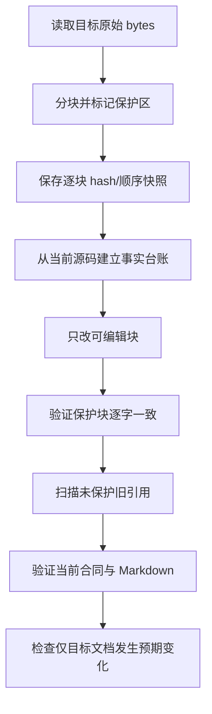

# `agent_knowledge_base.md` 现状同步 SPEC（待审阅）

> 本文档只规定后续如何同步知识库，当前不授权修改目标文档。
>
> 目标文件：仓库根目录 `agent_knowledge_base.md`。
>
> 本轮只新增本 SPEC；不得恢复、创建或修改已由用户删除的 `AGENTS.md`，不得修改生产代码、测试、Slurm 或已批准的 `SPEC_CANONICAL_PIPELINE_REFACTOR.md`。

## 1. Requirements（需求）

### 1.1 目标

在用户批准本 SPEC 后，把 `agent_knowledge_base.md` 中描述“代码当前如何工作”的内容同步到当前工作树：

- 当前目录和六个主线模块：`data.py`、`model.py`、`train.py`、`evaluation.py`、`main.py`、`phyEqns/ots_full_fourier.py`；
- 三物种速度分布到 full-Fourier OTS 光谱的正向计算；
- 电子多峰 EVDF、固定 H/C 离子分布、Fourier 标签、Parquet 与 manifest；
- train/validation 训练、严格 checkpoint、冻结 checkpoint 的独立 test 评估；
- `generate/train/evaluate/all` CLI、三个显式 ID 和流水线产物；
- 当前存在的测试目录和本地主线依赖，但不宣称未现场运行的测试“已通过”。

删除所有仅用于说明下列已删除本地旧版代码的记录、评论、命令、比较表和风险项：

```text
evaluateModel.py
genDataSet.py
genDataSet_full_fourier.py
quick_test.py
readData.py
train_v2.py
旧 ModelOTS / Loss_func / pet1 pickle 主线
```

但以下内容优先保护，不因其中出现旧文件名、`legacy`、`v2` 或旧指标而改写：

1. 与已经完成的训练任务及其结果、指标、产物、哈希、日志、checkpoint、Job ID 挂钩的记录；
2. 所有远程超算相关记录，包括 BSCC、上海交大 π、Slurm、分区、账号、远程路径、登录、上传下载、作业提交/监控/取消和远程环境；
3. 为理解上述保护记录所必需且位于同一不可拆 Markdown 块中的上下文。

### 1.2 用户故事

更新后，用户应能从知识库直接理解：

```text
三物种 f(v)
  -> full-Fourier 正向光谱
  -> train/test 数据与电子 Fourier 标签
  -> train/validation 选模
  -> model.pt
  -> 冻结模型的独立 test 指标与图
```

同时，既有超算运行事实和已经完成的训练证据仍保持原文，不能因本地主线重构而被重新解释或“清理掉”。

### 1.3 非目标

- 不恢复、创建或修改 `AGENTS.md`。
- 不修改或格式化生产代码、测试、Slurm、论文复现代码、报告及 canonical SPEC。
- 不运行训练、数据生成、评估、测试或超算查询；不刷新远程状态。
- 不重新验证论文声明或历史训练数值。
- 不引入新的长期维护脚本、框架、数据库、registry 或 ID 系统。

## 2. Design（设计）

### 2.1 事实来源与优先级

| 优先级 | 来源 | 用途 |
|---|---|---|
| 1 | 当前工作树中的六个主线源码 | 决定本地主线现在实际做什么 |
| 2 | 当前文件存在性、`rg --files` 和只读 Git 状态 | 决定当前结构及哪些旧文件已删除 |
| 3 | 已批准 `SPEC_CANONICAL_PIPELINE_REFACTOR.md` | 解释设计意图与边界；不能覆盖已实现源码 |
| 4 | `tests/*.py` 的文件和测试类清单 | 说明测试套件存在及覆盖领域；本任务不运行测试 |
| 5 | `agent_knowledge_base.md` 原文 | 只作为待更新文本及受保护历史/远程记录来源 |
| 6 | `OTS_paper.pdf` 和报告 | 只保留既有论文/历史语境；本次不重新审计 |

冲突规则：

1. “当前实现”以源码为准；canonical SPEC 若仍写“待实施”，不能据此把已经存在的实现写成未来计划。
2. 受保护历史文字即使与当前本地主线不一致，也保持原文；在相邻可编辑段落说明它是历史运行语境。
3. 远程状态不得现场刷新或用本地现状推断；原文逐字保留。
4. 未运行的测试只写“存在/覆盖”，不写“通过”。
5. 当前工作树含未提交修改时，知识库应明确事实来自“当前工作树”，不能伪称已发布或已提交版本。

### 2.2 当前事实清单

后续文档转换至少同步以下已经由源码确认的事实：

| 主题 | 当前事实 |
|---|---|
| 结构 | canonical 主线由 `data.py/model.py/train.py/evaluation.py/main.py` 加 `phyEqns/ots_full_fourier.py` 组成；六个旧根目录 Python 文件已经不存在 |
| 正向模型 | `OTS_spectrum_full_fourier` 接收电子、离子1、离子2各自的归一化 `v/f`；内部对三物种分别调用 `ft_x_n`，Fourier modes 共用且主线为 80 |
| 相速度取值 | 三种分布值从原始速度网格线性插值；网格外为 0，不外推、不周期回绕 |
| Fourier | `F(K)=∫f(v)e^{-iKv}dv`；`ft_x_n` 要求 `0<n<=N`，是显式梯形积分而非 FFT 切片 |
| 光谱 | 579/304/341 点三波段分别归一化后拼成 1224 维，因此波段间相对强度仍被丢弃；归一化比例必须 finite 且大于 0 |
| 数据 | 电子仍为三个背景 Gaussian 加一个弱热电子 Gaussian；H/C 离子为各自网格上的固定 Maxwellian；电子标签为 80 个复系数拆成 160 实数 |
| 默认物理配置 | 探针 351 nm、散射角 123°、`n_e=1.81e26 m^-3`、H/C 为 `Z=1/6` 与 fraction `0.55/0.45`、三物种零漂移；电子网格为 1000 点 `[-0.8c,0.8c]`，离子各为 1000 点 `±12` thermal speeds，离子参考温度 171.3 eV |
| 温度 | 每样本记录一维中心二阶矩的 mean velocity、effective temperature、与 1370 eV 配置参考值的 ratio；不因偏离参考值重缩放或拒绝样本 |
| 数据合同 | train/test 由 seed 与 seed+1 独立生成；Parquet 仍为 metadata-first 的 1384 列；loader 保留所有物理行 |
| manifest | 顶层严格为 `run_id/dataset_id/physical_configuration/splits`，不含 `checkpoint_id` |
| 模型 | `1224 -> hidden1 -> hidden2 -> 160`；每个隐藏层为 Linear/LayerNorm/LeakyReLU(0.05)/Dropout；输出经独立 Hermitian 投影 |
| 训练 | train Parquet 内固定划分 train/validation；统计量只来自 train；候选默认 `512,256;1024,512`；AdamW、ReduceLROnPlateau、梯度裁剪、early stopping，以最低 validation loss 选模 |
| 隔离 | `train.py` 不读取 test；test 只由 `evaluation.py` 在 checkpoint 冻结后读取 |
| checkpoint | `model.pt` 使用严格字段合同，保存三个 ID、模型状态、结构、标准化、网格、最佳 epoch/loss 和完整 optimizer/scheduler 训练配置；不保存 test 结果 |
| 评估 | 报告 coefficient MAE/RMSE/R²、Hermitian error、EVDF MAE/RMSE/R²、relative-L2 mean/median、negative-mass fraction；输出 metrics、predictions 和两张图 |
| CLI | `generate` 必需 run/dataset ID；`train/evaluate/all` 必需三个 ID；`all` 串联生成、训练、评估并写 config/summary |
| 测试 | 当前有 T1–T6 六个 `unittest` 模块；本次只记录其存在和覆盖范围，不运行也不修改 |

### 2.3 可更新范围

按当前知识库章节，后续允许更新：

| 章节 | 处置 |
|---|---|
| 顶部审阅信息、0–3 | 更新入口文件名、事实来源和当前结构；删除把 `AGENTS.md` 或旧 Python 文件描述为当前入口的文字 |
| 4–7 | 保留通用物理公式，改写为当前 full-Fourier 三物种实现、当前参数、数据/manifest 合同；删除旧生成器问题说明 |
| 8 | 原则上保留论文声明；只修正把旧代码误称为“当前实现”的连接文字 |
| 9 | 删除 legacy/v2 当前实现对照，改为“论文文字与 canonical 当前实现”的简明边界 |
| 10、11 | 删除未受保护的旧训练方法说明；可改写为 canonical 模型/训练/checkpoint，但保护的已完成训练和超算块保持原位原文 |
| 12 | 改写为当前 `evaluation.py` 和冻结 test 流程 |
| 13 | 更新 canonical 本地依赖与测试现状；任何远程环境段落逐字保护 |
| 14 | 本地动态状态可只读复核后更新；远程快照和已完成训练产物段落逐字保护 |
| 15 | 新增 canonical CLI；删除未受保护的旧本地命令；含远程命令的块按保护规则处理 |
| 16、17 | 用当前数据隔离、checkpoint、full-Fourier、评估和测试边界替换未保护的 legacy 风险/清单 |
| 18、19 | 术语和外部理论参考原则上保留，除非有明确旧代码路径引用 |
| 20 | 既有远程/完成训练维护条目逐字保护；实际完成知识库同步后只允许追加一条新维护记录，不回写旧条目 |

### 2.4 逐字保护规则

#### Markdown 块单位

先把原文解析成不可拆的语义块：

- ATX heading；
- 由空行分隔的普通段落；
- 单个列表项及其缩进续行；
- 表格的单行记录；
- 完整 fenced code block；
- blockquote 的连续块。

保护命中发生在块级。若一个块同时包含可删除旧说明和受保护内容，整个块标为 `mixed_protected`，不得局部编辑。

#### 远程超算保护

任何块只要包含下列之一，就进入 `protected_remote`：

- `BSCC`、北京超算、上海交大、`π`、`sjtu`、`bingxing`、远程/集群；
- `Slurm`、`slurm/`、`sbatch`、`squeue`、`sacct`、`scancel`、partition、Job/Jobs；
- 超算账号、登录技能、远程绝对路径、远程数据/结果目录、上传下载或模型注册；
- 与上述记录直接相连的表格标题、代码围栏、说明段落。

这里保护的是知识库原文，不是判断相关命令今天仍可运行。

#### 已完成训练保护

块同时具备“具体运行身份/结果”和“已完成训练语义”时进入 `protected_completed_training`。可识别信号包括：

- Job ID、run 目录、checkpoint/hash、日志或模型注册目标；
- `COMPLETED`、已完成、完成全量训练、正式作业、最终训练/最终 loss、旧日志最终值或恢复报告中的最终结果；
- 与具体运行绑定的 epoch/step、loss、R²、relative L2、耗时、候选模型或产物记录。

明确指向既存 smoke/run 目录、模型、指标和图的本地完成记录也按已完成训练保护；一般性的“将会输出哪些文件”不因此受保护。

单纯介绍旧算法、旧默认值、旧文件职责或一般风险不受保护，应删除。若完成训练结果与旧方法说明处于同一不可拆段落，保护优先。

#### 前后相等合同

实施前对每个保护块保存：

```text
category
original_order
raw_start/raw_end
exact_raw_bytes
sha256(exact_raw_bytes)
leading/trailing heading anchors
```

实施后必须证明：

1. 每个保护块都能按原始顺序定位到完全相同的字节序列；若原文存在内容相同的重复块，则重复次数必须与原文一致并按 ordinal 配对，否则单一块应恰好出现一次；
2. 所有保护块相对顺序不变；
3. 每块 SHA-256、长度和内容完全一致，包括空格、标点和换行；
4. 不允许通过重新换行、重排表格、格式化代码围栏或改变缩进来“等义改写”；
5. 新增澄清只能位于保护块之外。

### 2.5 旧版内容删除规则

在所有非保护块中：

1. 删除已删除文件的职责表行、使用说明、命令、错误清单、legacy/v2 对比和“当前入口”声明。
2. 删除已删除符号 `ModelOTS`、`Loss_func`、`load_model`/`pet1` pickle 被描述为当前主线的内容。
3. 不把旧内容仅改名为“历史”后继续保留；如果不属于保护记录，应直接删除。
4. 当旧段落讨论的概念仍存在时，用当前模块事实替换，例如把旧 v2 训练说明改为 `train.py`，而不是保留两份。
5. `phyEqns/ots_fourier.py`、`paper_reproduction/` 和报告仍存在，不能因为名称含 legacy 语境而误判为已删除；但不得把它们写成 canonical 主线。
6. 对 `mixed_protected` 中无法删除的旧名称，只在其前后添加简短边界说明；旧块本身保持逐字。
7. 更新后的“当前结构/命令/风险”章节不得再依赖已删除文件；受保护块不参与该断言。

### 2.6 目标文档建议结构

不强制整体重排；优先在现有章节中最小替换。更新后应能清楚找到：

```text
会话协议与事实来源
项目主线与当前目录
物理/Fourier/三物种正向模型
数据生成、温度派生值、Parquet/manifest
模型与 checkpoint
train/validation
独立 test evaluation
main CLI 与产物目录/JSON 关系
论文与 canonical 差异
依赖、测试、风险、验证清单
逐字保留的历史训练与远程超算记录
术语、参考和维护记录
```

### 2.7 文档转换与核验接口

本任务不新增或修改任何生产函数。以下接口是实施阶段一次性、只读审查与内存转换的接口式伪代码；可在临时进程中实现，不作为仓库长期架构。

#### `inventory_current_tree(root: Path) -> TreeInventory`

```text
require root/agent_knowledge_base.md and approved canonical SPEC exist
list current files with rg --files
record presence of six canonical modules and tests/*.py
record absence of the six explicit deleted Python files
read git status without changing it
return paths, presence facts and pre-edit status
```

#### `parse_markdown_blocks(raw: bytes) -> list[MarkdownBlock]`

```text
detect UTF-8/BOM and preserve original newline bytes
scan headings, blank-line paragraphs, list items, table rows, fences and blockquotes
for every block retain exact byte start/end and decoded text
reject unmatched fences or undecodable input
return blocks in source order without normalizing whitespace
```

#### `classify_protection(blocks: list[MarkdownBlock]) -> list[ProtectedBlock]`

```text
for each block evaluate remote markers and completed-training evidence
extend protection to inseparable fence/table/context blocks
if protected and stale markers coexist classify mixed_protected
never infer protection from the generic words model/train/checkpoint alone
return category, order, exact bytes and heading anchors
```

#### `capture_protected_snapshot(path: Path) -> ProtectedSnapshot`

```text
raw=read_bytes(path)
blocks=parse_markdown_blocks(raw)
protected=classify_protection(blocks)
for each protected block compute byte length and sha256
keep snapshot in memory or an external temporary location, not in target document
return original raw hash plus ordered protected records
```

#### `collect_current_facts(root: Path) -> FactLedger`

```text
read the six canonical source files completely
read approved SPEC as design context
read test filenames/class names only; do not execute tests
for every proposed current claim store source path, line anchor and observed value
mark source/spec conflicts and keep source behavior
return fact ledger; include no refreshed remote assertions
```

#### `rewrite_editable_blocks(raw: bytes, facts: FactLedger, protected: ProtectedSnapshot) -> bytes`

```text
copy every protected byte range verbatim and in original order
replace only editable blocks according to section map and fact ledger
delete unprotected stale legacy blocks rather than relabeling them
insert canonical current-state text and commands outside protected blocks
preserve target encoding/newline convention and balanced Markdown fences
return candidate bytes without writing any other file
```

#### `verify_protected_text(candidate: bytes, snapshot: ProtectedSnapshot) -> ProtectionReport`

```text
match protected records to exact raw byte sequences in monotonically increasing order
for unique blocks require exactly one occurrence; for duplicate blocks require original multiplicity and ordinal pairing
require same byte length and same sha256
require matched offsets preserve original protected-block order
report any missing, duplicate, reordered or altered block as fatal
return pass only when every record is exact
```

#### `scan_obsolete_references(candidate: bytes, protected: ProtectedSnapshot) -> list[Finding]`

```text
decode candidate without normalization
mask verified protected byte ranges
search remaining text for deleted filenames, old symbols and old local commands
allow a name only when explicitly stating that the file is deleted/absent
flag legacy/v2 current-entry claims, stale output schemas and stale risks
return line/block findings; require empty findings before write
```

#### `verify_current_contract(candidate: bytes, facts: FactLedger) -> ContractReport`

```text
require canonical module roles and generate/train/evaluate/all flow
require three-species v/f, internal Fourier, interpolation-zero-outside rules
require data dimensions, moments, manifest keys and seed separation
require train/validation/test isolation and checkpoint/test-result boundary
require metrics/artifacts and explicit ID rules
require test-suite wording says existence only, not unverified pass status
require no claim that deleted AGENTS.md is current or should be recreated
return missing/contradictory claims
```

#### `verify_document_scope(root: Path, before_status: str, target: Path) -> ScopeReport`

```text
check target Markdown fences and headings are structurally valid
check target exists and only its intended documentation diff was added by implementation
compare git status with before_status; preserve all pre-existing user changes
require AGENTS.md remains deleted and untouched
require source, tests, Slurm and canonical SPEC byte content unchanged
return changed-path and Markdown report
```

### 2.8 实施顺序



任何保护校验失败都必须停止，不得尝试自动“修复”历史原文。

## 3. Tasks（任务拆解）

1. **T1 — 基线与保护快照**：记录目标原始字节、Markdown 块、保护分类、逐块 hash、当前 Git 状态和允许变更路径。
2. **T2 — 当前事实台账**：从六个主线模块、canonical SPEC、当前文件清单和测试类清单建立带来源的事实表；不查询远程。
3. **T3 — 可编辑内容转换**：更新当前结构、正向计算、数据、模型、训练、评估、主流水线、依赖、命令和风险；删除未保护旧内容。
4. **T4 — 保护一致性核验**：逐块比较 bytes/hash/长度/出现次数/顺序；任一差异即停止。
5. **T5 — 内容与范围核验**：扫描非保护区旧引用，核对 canonical 当前事实、Markdown 结构和 Git 变更范围。
6. **T6 — 用户审阅**：只提交 `agent_knowledge_base.md` 的文档 diff 和保护核验摘要供用户审阅；不顺带修改其他文件。

依赖关系：T1、T2 完成后才能执行 T3；T4、T5 全部通过后才能进入 T6。

## 4. Acceptance Criteria / Tests（高层验收标准）

1. `agent_knowledge_base.md` 对当前结构、full-Fourier 正向、数据、模型、train/validation、独立 test evaluation 和 main 流水线的描述与当前源码一致。
2. 非保护区不再把任何已删除旧 Python 文件、旧模型/损失/pickle 或旧本地命令描述为当前或推荐路径。
3. 每个远程超算块及每个已完成训练记录块与修改前原始 bytes 完全相同，既不丢失也不新增重复，且顺序不变。
4. 混合保护块虽可保留旧名称，但有相邻的当前边界说明，且保护块本身没有任何字符变化。
5. 新知识库明确 `AGENTS.md` 已不再是当前入口，且实施没有恢复、创建或修改它。
6. 当前主线文件、CLI ID、1224/160/80 维度、三波段、manifest 顶层、checkpoint/test 隔离、指标与产物合同均被准确记录。
7. 测试只记录当前六个测试模块的存在和覆盖领域，不虚构本轮测试结果。
8. Markdown fences 成对，章节可读；没有因格式化而改变保护文本。
9. 实施阶段只修改目标知识库；生产代码、测试、Slurm、canonical SPEC、论文、报告和用户既有修改保持不变。
10. 本 SPEC 审阅阶段仅新增 `SPEC_AGENT_KNOWLEDGE_BASE_REFRESH.md`，目标知识库保持原样。
