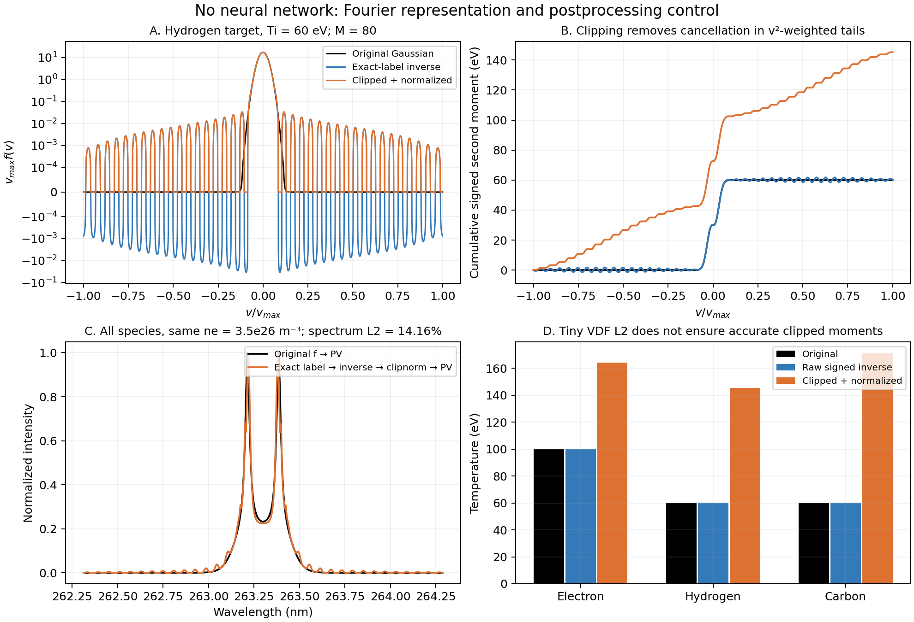

# Fourier representation audit, 2026-10-23

The current evaluation VDF error compares a neural prediction with the **inverse transform of its Fourier label**, not with the original physical VDF. Even exact labels can give small VDF relative-L2 but large temperature and spectrum changes after clipping negative sidelobes. This was reproduced without a neural-network call, using existing sampler, Fourier, inverse, moment and PV APIs.

## Inputs and study scope

- Current source HEAD: `a092bd7d4de26acb695415155f9c608594b9a0dc`. Source and input SHA-256 hashes are in [results.json](results.json); source/data/model hashes before and after the existing-row audit match.
- Eight deterministic existing physical rows: all four `cloud_fig_e2198eeab80d` test rows and the first four train rows. Its checkpoint was read **only for layout/coordinates**, with no model creation, inference, training, or claimed model-performance result.
- Three additional standalone **diagnostic states**, explicitly authorized as controlled analysis: Gaussian Te/Ti = 100/60, 209/78, 1392/912 eV, all mean velocities zero, ne = 3.5e26 m^-3. They are not existing-row replay or newly generated training datasets. No Parquet or registry output was written.
- The existing-row checks use labels and layout from the 16+4 Fig smoke dataset. They do not establish each row’s original physical VDF or ne/T/u, which cannot be inferred uniquely from Fourier labels. Original-f errors and PV-at-original-ne comparisons therefore remain unmeasured for these rows.
- These are target-label and known-truth controls, not a performance evaluation of D4. They do not identify the contributions to D4 prediction error.

## What the code measures

1. `data.py:424–481` computes the saved spectrum directly from original physical f via `OTS_spectrum_PV`, while labels are independently computed with `ft_x_n`. Manifest actual T/u are computed from original f; expected T/u are distinct sampler targets.
2. `evaluation.py:140–210` reconstructs target and predicted labels with the same inverse, then computes relative-L2 between those two reconstructions. Its saved `true_evdf` therefore means **reconstructed label**. With target used as prediction, VDF relative-L2 is exactly zero by construction. That zero says nothing about original-f error or physical moments.
3. `evaluation.py:53–98` is an explicit finite-K trapezoidal inverse. New checkpoint layouts request the original velocity grid (`evaluation.py:525–532`); old checkpoints use an M-point derived grid. Both paths are recorded in the existing-row table.
4. `model.py:110–127` imposes Hermitian symmetry, which ensures a real inverse. It does not impose nonnegative f, unit integral, prescribed mean or prescribed temperature. Temperature and forward-spectrum closure are not part of the reported VDF relative-L2 metric.
5. Public `distribution_moments` and `OTS_spectrum_PV` reject negative f. Raw inverse signed moments here are explicitly diagnostic full-support trapezoidal arithmetic, with signed normalization; they are not claimed to be moments of a physical nonnegative density. Clipped moments reuse the original positive-density public API.

## Known-truth, no-NN causal control

All states use existing `Fig1_Fig11_sampler.sample_*_vdf` methods. Only private config fields `points_csv` and Gaussian shape probability `[1,0,0]` were overridden. Sampler target parameters were explicitly set; sampling of other physical parameters was bypassed. All three original f arrays are therefore known. The anchors file is existing `/workspace/ots-cloud-setup/data/paper_experimental_points.csv`; its hash is recorded. Original double-precision `ft_x_n` labels pass to the unchanged inverse on the same original Nv4097 axes. The clipped reconstructions are normalized with the existing API and sent to unchanged `OTS_spectrum_PV`, at the same true ne, wavelength grid and physical configuration as original f.

| Te / Ti (eV) | Species | Raw inverse VDF L2 vs original | Original T (eV) | Raw signed T (eV) | Clip + normalize T (eV) |
|---|---|---:|---:|---:|---:|
| 100 / 60 | e | 0.2863% | 100 | 100.198 | 164.144 |
| 100 / 60 | H | 0.5753% | 60 | 60.263 | 145.219 |
| 100 / 60 | C | 0.7244% | 60 | 60.343 | 171.102 |
| 209 / 78 | e | 0.00109% | 209 | 209.001 | 209.325 |
| 209 / 78 | H | 0.1491% | 78 | 78.074 | 102.124 |
| 209 / 78 | C | 0.2005% | 78 | 78.104 | 111.506 |
| 1392 / 912 | e/H/C | below 7e-13% | 1392/912/912 | same to roundoff | same to roundoff |

Original-f PV versus all-three-species clip-normalized inverse PV relative-L2 is **14.156%**, **6.944%**, and **3.19e-11%**, respectively. No spectrum is computed from raw signed inverse f, because the public API requires a physical nonnegative density. All species were replaced together; these controls do not attribute spectral discrepancy to one species alone.

In the 100/60 state, inverse negative-mass fractions are only 0.255% / 0.554% / 0.704% for e/H/C. Raw signed norms are within 3.3e-6 of one and reconstructed means remain zero to roundoff. Thus the large clipped T changes are not primarily a normalization defect or a drift mistake. Positive and negative distant sidelobes nearly cancel under signed integration; clipping removes the negative part, leaving distant positive mass whose v² weighting strongly raises T. Even clipped VDF relative-L2 remains small: 0.363% / 0.754% / 0.956%.

## Eight existing-row target-only checks

Full tables: [moments.csv](moments.csv), [results.json](results.json). Physical indices below are zero-based; Parquet physical row = index+1 because row zero contains coordinates.

| Existing row | Species | Raw signed T | Clip-normalized T | Negative-mass fraction |
|---|---|---:|---:|---:|
| train index 1 | H | 48.020 eV | 317.919 eV | 1.923% |
| train index 2 | H | 52.490 eV | 197.994 eV | see CSV |
| test index 1 | H | 101.047 eV | 144.958 eV | see CSV |

Across the eight rows, raw norms are close to one (H range 0.9999980–1.0000034). Electron clipping changes T by at most 1.259 eV in these particular rows. These are representation/postprocessing differences of saved exact target labels. Without an original-f comparison for these rows, neither raw nor clipped temperatures can be declared correct against physical truth.

## M80 grid, aliases, and sensitivity

The current `ft_x_n` uses `N*dv` as nominal length and `linspace(-1,1,M)*M/2` for K. The actual spacing is

`dK = 2π/(N*dv) * M/(M−1)`.

For even M=80, the grid has half-integer frequencies and **no K=0** sample. There is no directly supervised F(0)=1. Hermitian symmetry does not supply that missing condition. The inverse is a finite sum with antiperiod P=2π/dK: with an exactly uniform even-M grid, `f(v+P) = -f(v)`; its full period is 2P. The existing original support is about 1.01241P wide. That antiperiodic continuation and finite-K cutoff can contaminate edge/tail integrals. On saved float32 K metadata, the measured relative max antiperiodicity residual is 2.1e-5–7.3e-5, consistent with rounded K spacing. This is a property of the current representation, not proof that aliasing alone causes a particular neural prediction error. Full-support and old M-grid moments are separately saved; changing the integration axis changes the diagnostic.

For normalized fixed-mean densities, a perturbation changes T through `(m/e) ∫(v−u)² δf dv`. Unweighted VDF L2 emphasizes the large central peak, while temperature strongly emphasizes remote tails. For the saved H velocity bound 3.263e6 m/s, `m_H*vmax²/e ≈ 111,172 eV`: roughly 1.8% uncompensated mass placed near that edge has a 2 keV second-moment scale. This is a sensitivity estimate, **not an observed 2 keV error in these rows or in D4**. The largest measured existing-label clipping change here is 270 eV; known-truth H clipping biases in the three Gaussian controls are 85.2, 24.1, and approximately zero eV.

PV closure is additionally sensitive to local f and its discrete derivative, a principal-value response, dielectric denominators and peak normalization (`ots_full_fourier.py:781–857, 1039–1086`). A small unweighted f error does not bound those operations tightly. In the cold Gaussian controls, large spectral discrepancies arise at exactly known ne with no model error. The results quantify a **baseline for this specific transform/inverse/postprocessing chain**, not a universal irreducible lower bound over all possible reconstructions.

## Practical interpretation

An additional strictly limited [positive-tail control](POSITIVE_TAIL_REPORT.md) separates temperature sensitivity from clipping: changing only H by a symmetric 1.8% remote-tail mixture changes its physical temperature 78→1882 eV or 912→2701 eV, at VDF L2 2.33–3.27% and normalized spectral L2 0.80–1.47%, with no negative values, clipping, inverse or NN. It is a deliberately constructed VDF-space perturbation, not an existing-sampler draw or D4 attribution.

The evidence supports a representation/postprocessing contribution to the temperature and spectral disagreement. In particular, a high VDF score against reconstructed labels cannot certify temperature accuracy against original f, and clipping is consequential. The evidence does not quantify neural-model error for D4 or prove that its approximately 2 keV hydrogen result is wholly caused by Fourier representation. Establishing that attribution requires a frozen D4 checkpoint and matched manifest/data/source, followed by a comparison of original f, exact-label inverse and neural inverse under the same signed and clip-normalized conventions and true ne.

Reproduce the standalone scripts with `/workspace/ots/.venv/bin/python` in order: [audit_representation.py](audit_representation.py), [controlled_states.py](controlled_states.py), [make_figure.py](make_figure.py). Numerical results are [controlled_results.json](controlled_results.json), `controlled_arrays.npz`, `target_reconstructions.npz`; figure exports are [PNG](representation_control.png) and [PDF](representation_control.pdf). The diagnostics are separate from the production training workflow.

The NPZ arrays named here are external numerical inputs/results and are not included in this public code-and-report branch.
