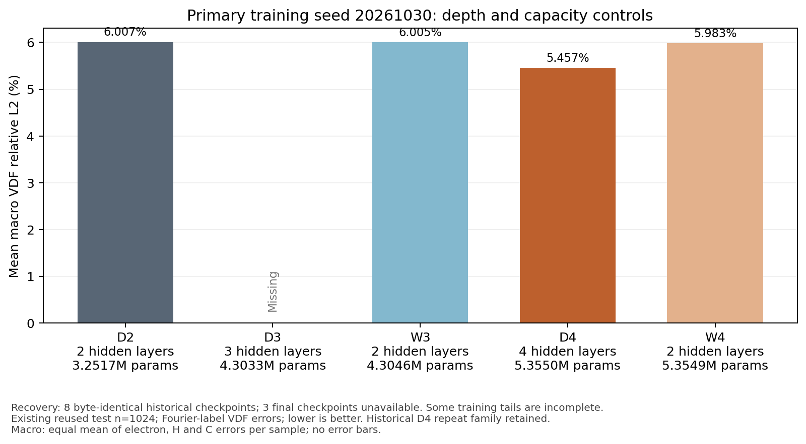
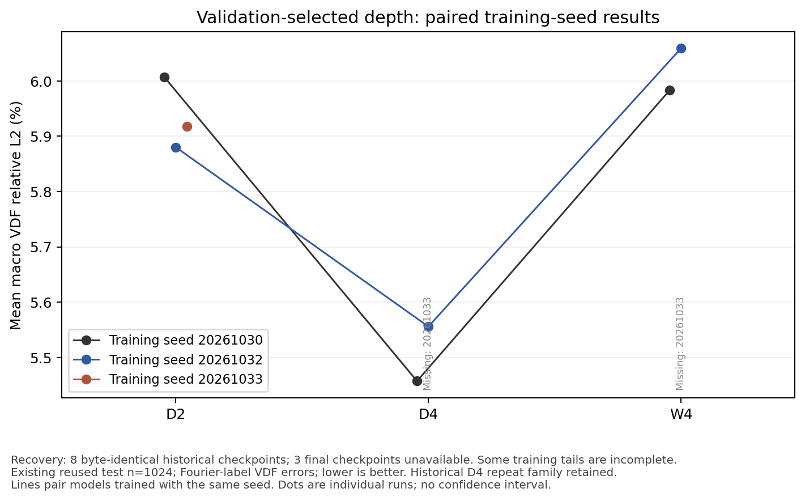

# Fig 深度实验恢复报告

生成时间：2026-10-24T06:42:30.870585+00:00。

11 组按原结构、种子、数据和完整流程两小时上限串行重放。4 组完整完成；另4组保存的最佳 checkpoint 与历史 SHA-256 完全一致，但训练尾部缺失。D3 s0、D4 s2、W4 s2 的历史最终权重仍未恢复，保留当前部分重算权重、优化器和全部随机状态。

以上均为本轮重算或从本轮快照导出，不是从旧磁盘找回原件。字节一致只证明对应 checkpoint 身份，不证明完整训练历史恢复，也不证明未完成流程能在两小时内完成。

现有21份生成/训练/评估/物理源码保持不变。原暂停/续训验证已在真实重算归档上完整通过；预检报告另保留。

下表 validation 读当前保存模型；缺失历史最终权重的三行是部分模型指标。Test 主对照只纳入8份与历史一致的 checkpoint；不以部分模型替代缺失历史最终模型。

| run | 已完成/当前最佳轮 | 恢复状态 | 当前 validation 宏误差 | 已恢复历史 checkpoint Test 宏误差 | 已花费保守分钟 |
| --- | --- | --- | --- | --- | --- |
| depth_fig_d2_s0 | 192/157 | 完整流程完成 | 5.812357% | 6.006846% | 117.898 |
| depth_fig_d2_s1 | 188/153 | 完整流程完成 | 5.737390% | 5.880257% | 112.845 |
| depth_fig_d2_s2 | 203/168 | 完整流程完成 | 5.763713% | 5.918195% | 115.690 |
| depth_fig_d3_s0 | 178/169 | 仅部分重算；历史最终权重缺失 | 5.407519% | 历史最终模型不可用 | 118.065 |
| depth_fig_d4_s0 | 163/160 | 仅最佳权重匹配历史；训练尾部缺失 | 5.297634% | 5.457244% | 118.136 |
| depth_fig_d4_s1 | 125/118 | 仅最佳权重匹配历史；训练尾部缺失 | 5.379141% | 5.555828% | 118.234 |
| depth_fig_d4_s2 | 134/130 | 仅部分重算；历史最终权重缺失 | 5.350094% | 历史最终模型不可用 | 118.199 |
| depth_fig_w3_s0 | 157/122 | 完整流程完成 | 5.793958% | 6.004846% | 116.978 |
| depth_fig_w4_s0 | 148/122 | 仅最佳权重匹配历史；训练尾部缺失 | 5.808110% | 5.983371% | 118.087 |
| depth_fig_w4_s1 | 121/103 | 仅最佳权重匹配历史；训练尾部缺失 | 5.850715% | 6.059057% | 118.060 |
| depth_fig_w4_s2 | 129/127 | 仅部分重算；历史最终权重缺失 | 5.748008% | 历史最终模型不可用 | 118.163 |

“已花费”包含父 all 耗时；对于中断项，它不是完整流程总时间。缺失的训练尾部没有插值、编造或继续训练补齐。

8份已恢复 checkpoint 中按 validation 最小者：depth_fig_d4_s0。这不是原11组全部恢复后的重新确认。

图中缺项留空，不能据此声称完整三种子深度效果已复现。各物种指标、配对区间和哈希见 analysis/final；区间只以已保存 checkpoint 为条件，不涵盖选模或重训不确定性。

