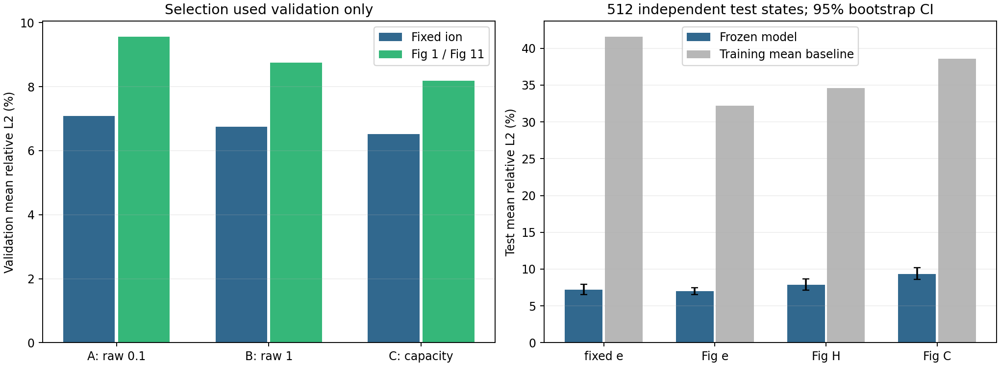

# Fixed ion / Fig 初始训练研究：本轮重算报告

本报告全部数值读取本轮执行产物。历史报告保存在 recovered_text，历史报告中的旧结论不等于本轮结果；重训权重不是找回的历史权重。

报告生成时间：2026-10-24T02:51:30.301401+00:00。

完整耗时使用本轮运行器的 monotonic 实测；兼容旧汇总器的 real 行是该实测值的文本表示，不是额外运行 Bash time。使用缓存数据的尾流程还计回父 all 的完整耗时。

宏平均是物种等权的 VDF 相对 L2 误差，越小越好。它比较 Fourier 低通标签，不能直接代表原始物理分布、温度矩或重建光谱的误差。

恢复目标是原六次流程及其研究产物，不进行新的调参。A→B 只把 raw-loss 权重从 0.1 调到 1；C 按历史候选扩展容量，候选内部按原 validation loss 选择 checkpoint。最终分析保留历史选定的 run 身份；本轮 validation 排名在下表单独列出。

| 数据族 | 历史选择的本轮重训 run | 本轮 validation 排名（好→差） |
| --- | --- | --- |
| fixed_ion | study_fixed_c | study_fixed_c, study_fixed_b, study_fixed_a |
| fig1_fig11 | study_fig_c | study_fig_c, study_fig_b, study_fig_a |

## 全部网络尝试

| Run | 隐藏层 | Dropout | raw权重 | 参数量 | 最佳/停止epoch | 最佳val loss | 对应train loss | 训练耗时 | 保留checkpoint |
|---|---|---|---|---|---|---|---|---|---|
| study_fixed_a | 512×256 | 0.0 | 0.1 | 801184 | 113/148 | 0.175161 | 0.008095 | 63.4s | 是 |
| study_fixed_b | 512×256 | 0.0 | 1.0 | 801184 | 90/125 | 0.053310 | 0.004237 | 44.3s | 是 |
| study_fixed_c | 512×512 | 0.0 | 1.0 | 973984 | 50/90 | 0.059664 | 0.008207 | 34.5s | 否 |
| study_fixed_c | 1024×512 | 0.02 | 1.0 | 1864352 | 85/125 | 0.052005 | 0.006591 | 76.0s | 否 |
| study_fixed_c | 1024×1024 | 0.02 | 1.0 | 2472096 | 75/115 | 0.051926 | 0.007649 | 89.9s | 是 |
| study_fig_a | 512×256 | 0.0 | 0.1 | 420064 | 70/105 | 0.418674 | 0.152127 | 28.5s | 是 |
| study_fig_b | 512×256 | 0.0 | 1.0 | 420064 | 70/105 | 0.148057 | 0.049950 | 31.3s | 是 |
| study_fig_c | 512×512 | 0.0 | 1.0 | 674784 | 82/122 | 0.145686 | 0.036426 | 50.9s | 否 |
| study_fig_c | 1024×512 | 0.02 | 1.0 | 1101792 | 93/133 | 0.143245 | 0.043435 | 81.7s | 是 |
| study_fig_c | 1024×1024 | 0.02 | 1.0 | 1873376 | 88/128 | 0.143651 | 0.038336 | 95.7s | 否 |

## 六次完整流水线

| Run | 保留网络 | Val各物种L2 | Val宏平均 | Test各物种L2 | Test宏平均 | 完整耗时 |
|---|---|---|---|---|---|---|
| study_fixed_a | 512×256 | 7.083% | 7.083% | 7.861% | 7.861% | 18.04min |
| study_fixed_b | 512×256 | 6.749% | 6.749% | 7.442% | 7.442% | 15.94min |
| study_fixed_c | 1024×1024 | 6.524% | 6.524% | 7.189% | 7.189% | 19.00min |
| study_fig_a | 512×256 | 7.600% / 9.404% / 11.704% | 9.569% | 7.699% / 9.920% / 11.180% | 9.600% | 19.04min |
| study_fig_b | 512×256 | 7.227% / 8.560% / 10.482% | 8.756% | 7.280% / 8.554% / 9.959% | 8.598% | 19.66min |
| study_fig_c | 1024×512 | 7.038% / 7.948% / 9.593% | 8.193% | 6.986% / 7.838% / 9.361% | 8.062% | 23.12min |

## 最佳模型的独立测试

| 目标 | 平均L2 | 95% CI | 中位L2 | p95 L2 | 全局R² | 平均负质量 | 均值基线L2 |
|---|---|---|---|---|---|---|---|
| fixed e | 7.189% | 6.550%–7.934% | 4.354% | 23.397% | 0.985418 | 1.199% | 41.609% |
| Fig e | 6.986% | 6.546%–7.465% | 5.270% | 19.292% | 0.991566 | 0.711% | 32.194% |
| Fig H | 7.838% | 7.135%–8.673% | 4.958% | 24.968% | 0.980846 | 1.225% | 34.602% |
| Fig C | 9.361% | 8.601%–10.180% | 6.636% | 29.460% | 0.976090 | 1.568% | 38.616% |

## 温度诊断

| 目标 | 直接积分MAE/eV | Taylor3 MAE/eV | Taylor3中位相对误差 | 负T 直接/Taylor | 非有限 直接/Taylor | 真Fourier经Taylor3偏差MAE/eV |
|---|---|---|---|---|---|---|
| fixed e | 300.92 | 136.26 | 7.581% | 11 / 0 | 0 / 0 | 20.68 |
| Fig e | 240.65 | 132.65 | 14.260% | 25 / 0 | 0 / 0 | 2.73 |
| Fig H | 141.02 | 38.98 | 8.475% | 62 / 4 | 0 / 0 | 1.22 |
| Fig C | 147.85 | 55.80 | 12.825% | 51 / 5 | 0 / 0 | 0.91 |

## 原始分布与低通标签

| 目标 | 模型→原VDF均值L2 | 模型→原VDF p95 | 标签→原VDF均值L2 | 标签→原VDF p95 | 标签→原VDF最大L2 |
|---|---|---|---|---|---|
| fixed e | 7.347% | 23.766% | 1.008% | 4.100% | 10.841% |
| Fig e | 6.990% | 19.294% | 0.071% | 0.353% | 4.523% |
| Fig H | 7.864% | 24.969% | 0.273% | 1.551% | 6.447% |
| Fig C | 9.402% | 29.501% | 0.312% | 2.041% | 9.720% |

原研究脚本生成的温度诊断、原始 VDF 对照及物理探针保存在 exploration。这些诊断不改变训练、标签或已冻结模型。

